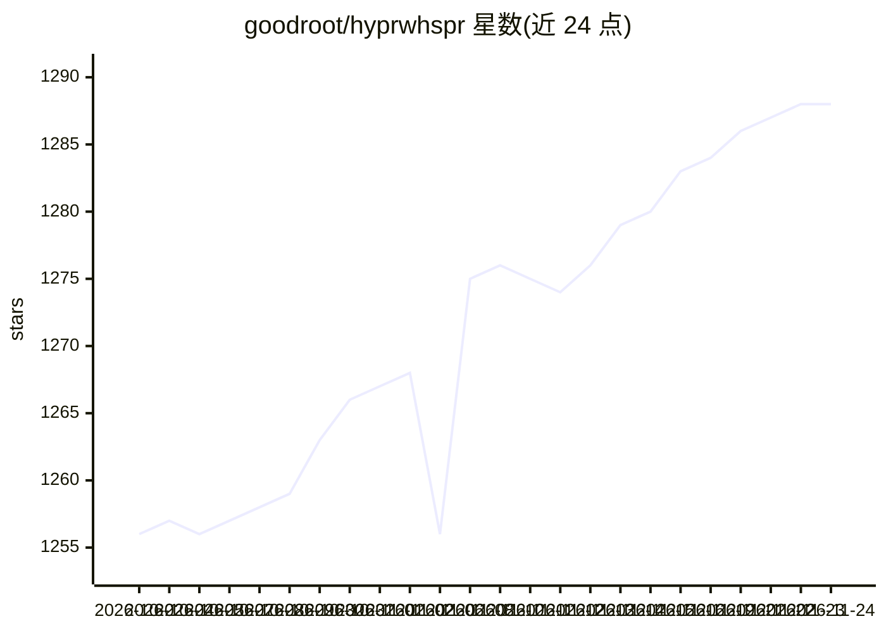

# goodroot/hyprwhspr

⭐ 1,288 · Python · MIT · 推送 2026-11-22 · [GitHub](https://github.com/goodroot/hyprwhspr) · [官网](https://hyprwhspr.com) · 个人维护

**Linux 全系统级语音听写工具：本地离线转写并自动粘贴**

面向 Linux 桌面用户的系统级语音听写工具，通过热键（默认 Super+Alt+D）录音并将语音转写为文本，粘贴到当前活动窗口。支持多种转写后端（本地 onnx-asr 模型、Whisper.cpp、Qwen3-ASR、Parakeet，以及可选的云端 REST API），默认离线运行，转写不经外部服务。提供交互式 setup 命令、CLI 管理命令（模型下载/卸载、录制控制、文件转写）、状态栏可视化、CJK 语言支持与非英语到英语的翻译。

## 筛选速览

| 维度 | 判定 | 备注 |
|---|---|---|
| AI 角色 | `ai-native` | 本体是模型或模型工具 |
| 许可风险 | `permissive` | MIT |
| 部署形态 | `None` |  |
| 模型依赖 | locked-api |  |
| 硬件要求 | — | 无带数字的原话,不猜 |
| 安装摩擦 | `low` | 无编译、无系统依赖或容器化 |
| 成熟度 | — | 结构信号不足 |

## 能力要点

- 热键触发的系统级听写，转写文本自动粘贴到活动窗口
- 默认本地离线转写，云 API 完全可选
- 多后端可选：onnx-asr/Whisper.cpp/Qwen3-ASR/Parakeet/云端 API
- 提供 CLI 管理命令与 WAV/MP3 文件转写

## 适用场景

- 在任意输入框中按热键口述输入文本
- 离线环境下进行私密语音转写
- 长篇口述写作（支持暂停续录保存）

## 场景标签

`语音识别` · 领域:感知与多模态

## 证据(README 行号)

> L3:  Native speech-to-text for Linux - Fast, accurate, private and hackable system-wide dictation
> L14: - **Very fast defaults** - Nearly instant and accurate performance via in-memory models
> L15: - **Offline and private** - Transcription never leaves your machine. Cloud APIs are fully optional.

## 星数曲线

2026-10-22 1,256 → 2026-11-24 1,288（+32）

---
*卡片 v1 · prompt 1.4 · 生成 2026-11-23 · 置信度 high · 依据 README sha `06f9cae382dc` · [字段定义](../../DATASET.md)*
