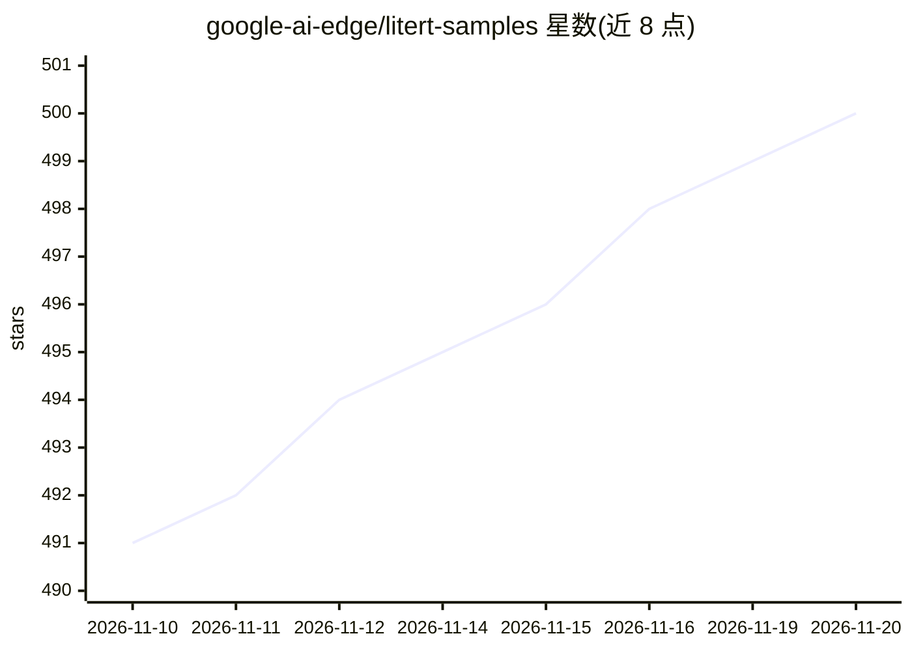

# google-ai-edge/litert-samples

⭐ 500 · Python · Apache-2.0 · 推送 2026-11-17 · [GitHub](https://github.com/google-ai-edge/litert-samples) · [官网](https://developers.google.com/edge/litert) · 组织维护

**Google AI Edge 官方端侧 ML/GenAI 示例应用、模型转换配方与 agent 技能库**

Google AI Edge 团队维护的 LiteRT 与 LiteRT-LM 中央开发者仓库：提供 Android/iOS/Flutter/Web/Linux/Raspberry Pi 等平台的示例应用（模型动物园、语音助手、语音机器人、Flutter 多模态助手）、模型转换与量化配方、真机云基准测试（DDP Colab）以及 9 个 SKILL.md 格式的 AI 编码 agent 技能。示例与 Hugging Face litert-community 的 400+ 预转换模型集成，无需手动转换。关键机制：CompiledModel API 提供 GPU/NPU 自动加速，LiteRT-LM 负责 LLM 推理编排；本体为示例代码集合而非可安装运行时。

## 筛选速览

| 维度 | 判定 | 备注 |
|---|---|---|
| AI 角色 | `ai-ecosystem` | LLM/agent 周边工具 |
| 许可风险 | `permissive` | Apache-2.0 |
| 部署形态 | `library` | 以包/库形式分发 |
| 模型依赖 | — | README 未给出锁定关系 |
| 硬件要求 | — | 无带数字的原话,不猜 |
| 安装摩擦 | `low` | 无编译、无系统依赖或容器化 |
| 成熟度 | — | 结构信号不足 |

## 能力要点

- 涵盖 Android/iOS/Flutter/Web/树莓派等多平台的示例应用集合
- 模型转换、量化与验证的可复现配方（models/）
- 9 个供 AI 编码 agent 使用的端到端 SKILL.md 技能手册（skills/）
- 与 litert-community 400+ 预转换模型及 Google Cloud DDP 真机基准集成

## 适用场景

- 把预转换模型直接集成进移动/桌面/Web 端侧 AI 应用
- 将 PyTorch/HF checkpoint 转换、量化为 .tflite/.litertlm 端侧模型
- 在真机（含 NPU/TPU）上运行基准测试对比性能
- 让 AI 编码 agent 按 SKILL.md 手册自动化端侧模型开发流程

## 场景标签

`模型评测` `模型量化` · 领域:评测与运维

## 证据(README 行号)

> L5:  **Official sample applications, end-to-end model conversion recipes, model benchmarks, and AI coding agent skills f
> L21: Welcome to **`litert-samples`** — the central developer hub for
> L25: Whether you want to **try a model in your browser in 30 seconds**, **drop a pre-converted model from Hugging Face `

## 星数曲线

2026-11-10 491 → 2026-11-20 500（+9）

---
*卡片 v1 · prompt 1.4 · 生成 2026-11-17 · 置信度 mid · 依据 README sha `adbef6b19901` · [字段定义](../../DATASET.md)*
