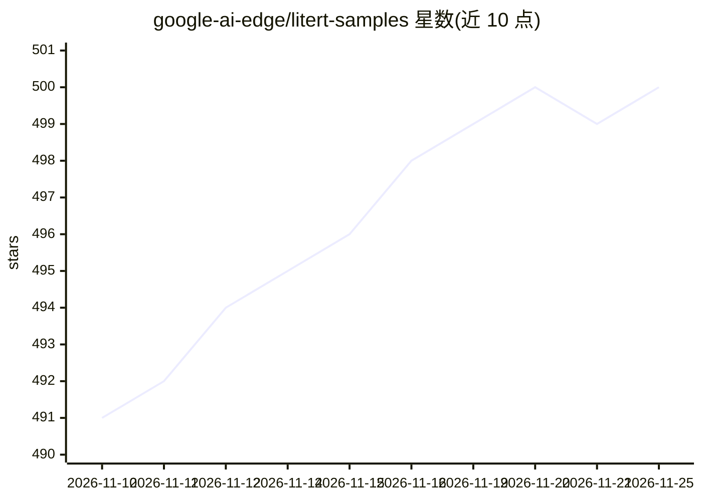

# google-ai-edge/litert-samples

⭐ 500 · Python · Apache-2.0 · 推送 2026-11-23 · [GitHub](https://github.com/google-ai-edge/litert-samples) · [官网](https://developers.google.com/edge/litert) · 组织维护

**LiteRT 端侧推理示例集：帮助开发者运行与转换端上模型**

google-ai-edge 的开发者中心仓库，汇集 LiteRT（端侧推理运行时）与 LiteRT-LM（LLM 编排层）的示例应用、模型转换与量化流程、真机基准测试以及面向 AI 编码 agent 的 SKILL.md 技能。示例覆盖 Android/iOS/Flutter/Web/Linux/Raspberry Pi 等平台，模型权重从 Hugging Face litert-community 按需下载；入门路径按 Level 1–5 从浏览器演示递进到模型转换与云端真机基准。本仓库为示例集合，运行时本体在其他仓库。

## 筛选速览

| 维度 | 判定 | 备注 |
|---|---|---|
| AI 角色 | `ai-ecosystem` | LLM/agent 周边工具 |
| 许可风险 | `permissive` | Apache-2.0 |
| 部署形态 | `library` | 以包/库形式分发 |
| 模型依赖 | — | README 未给出锁定关系 |
| 硬件要求 | — | 无带数字的原话,不猜 |
| 安装摩擦 | `low` | 无编译、无系统依赖或容器化 |
| 成熟度 | — | 结构信号不足 |

## 能力要点

- 34 任务的 LiteRT Model Zoo 示例应用（21 视觉/8 音频/5 文本）
- 客户端 WebGPU/WASM 浏览器演示（SAM 2.1、CLIPSeg、PP-OCRv5、Matcha-TTS 等）
- 覆盖 MiniCPM5-2B、Qwen3、SAM 3 等的端到端转换/量化流程
- 9 个面向 AI 编码 agent 的 SKILL.md 技能

## 适用场景

- 把 litert-community 的预转换模型跑在手机或树莓派上
- 参考流程把 PyTorch/HF 检查点转换为 .tflite/.litertlm
- 在浏览器里零安装体验端侧推理演示
- 用 litert CLI 下载并在本地或云端真机基准测试模型

## 场景标签

`模型评测` `模型量化` `推理引擎` · 领域:评测与运维

## 证据(README 行号)

> L21: Welcome to **`litert-samples`** — the central developer hub for
> L59: |**`google-ai-edge/litert-samples`** *(You are here)*|Reference apps (Android, iOS, Flutter, Web, Linux/Pi), conver
> L99: 2. **Level 2 — 3-Minute CLI Quickstart**: Download, run, and benchmark any `litert-community` model in 3 commands.

## 星数曲线

2026-11-10 491 → 2026-11-25 500（+9）

---
*卡片 v1 · prompt 1.4 · 生成 2026-11-25 · 置信度 high · 依据 README sha `71f84e9c4188` · [字段定义](../../DATASET.md)*
