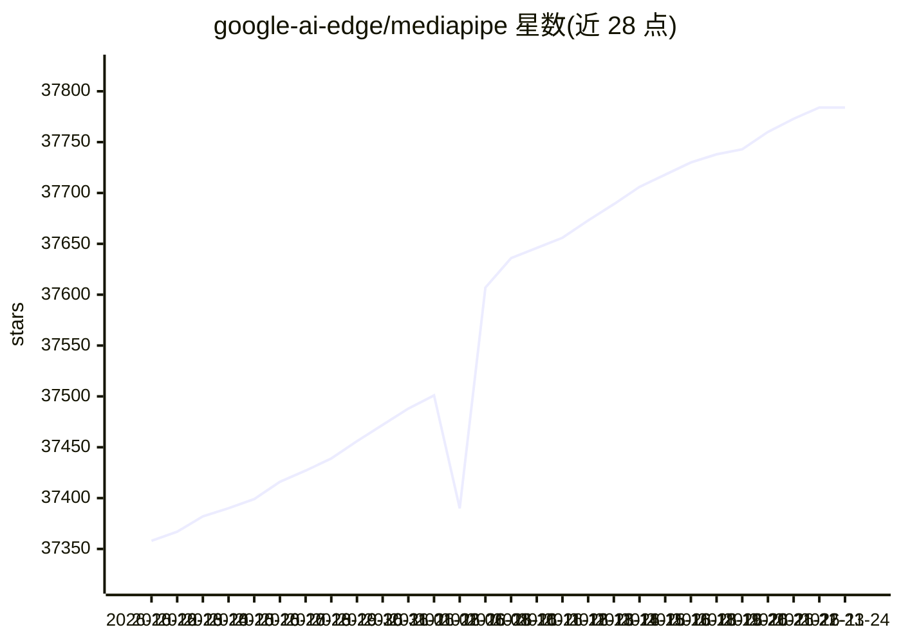

# google-ai-edge/mediapipe

⭐ 37,784 · C++ · Apache-2.0 · 推送 2026-11-22 · [GitHub](https://github.com/google-ai-edge/mediapipe) · [官网](https://ai.google.dev/edge/mediapipe) · 组织维护

**端侧实时流媒体 ML 解决方案库：移动/桌面/IoT 部署**

Google 开源的端侧机器学习方案集，面向希望为应用添加 ML 功能的开发者，覆盖 Android、iOS、Web、桌面、边缘设备与 IoT。由三部分组成：MediaPipe Tasks 提供跨平台 API 与部署库；配套预训练模型直接用于各解决方案；MediaPipe Studio 在浏览器中可视化、测试与基准评估。另提供低层 Framework，以 Packets/Graphs/Calculators 图结构构建端侧推理管线，可用 C++、Android、iOS 构建示例应用。数据在设备上处理，不上传到 Google 服务器，但 API 会发送性能与使用指标。

## 筛选速览

| 维度 | 判定 | 备注 |
|---|---|---|
| AI 角色 | `ai-native` | 本体是模型或模型工具 |
| 许可风险 | `permissive` | Apache-2.0 |
| 部署形态 | `None` |  |
| 模型依赖 | — | README 未给出锁定关系 |
| 硬件要求 | — | 无带数字的原话,不猜 |
| 安装摩擦 | `low` | 无编译、无系统依赖或容器化 |
| 成熟度 | — | 结构信号不足 |

## 动量与使用信号

- 维护:`active` — 距上次 push 1.5 天,年发版 6,109 位贡献者
- 涨星:近 1 天 **+5**(自 20261016 起算)
- 安装:github 包 `release-assets` 月下载无数据
- 平台:ANDROID / IOS · 协议:—

## 能力要点

- MediaPipe Tasks 跨平台 API 与库，覆盖 Android/iOS/Web/桌面/边缘设备/IoT
- 提供各解决方案配套的预训练即用模型
- Framework 以 Packets/Graphs/Calculators 图结构构建端侧 ML 管线
- 输入数据（图像/视频/文本）在设备端处理，不发送至 Google 服务器

## 适用场景

- 在移动应用中集成视觉/音频等实时 ML 功能
- 为不应离开设备的数据做本地推理处理
- 在浏览器中测试与基准评估解决方案
- 用 C++/Android/iOS 构建自定义端侧推理管线

## 场景标签

`图像视频处理` `目标检测` · 领域:感知与多模态

## 证据(README 行号)

> L6: **On-device machine learning for everyone**
> L48: * **MediaPipe Tasks**: Cross-platform APIs and libraries for deploying
> L51: * **MediaPipe models**: Pre-trained, ready-to-run models for use with each

## 星数曲线

2026-10-22 37,358 → 2026-11-24 37,784（+426）

---
*卡片 v1 · prompt 1.4 · 生成 2026-11-22 · 置信度 high · 依据 README sha `1e78a799d4bf` · [字段定义](../../DATASET.md)*
