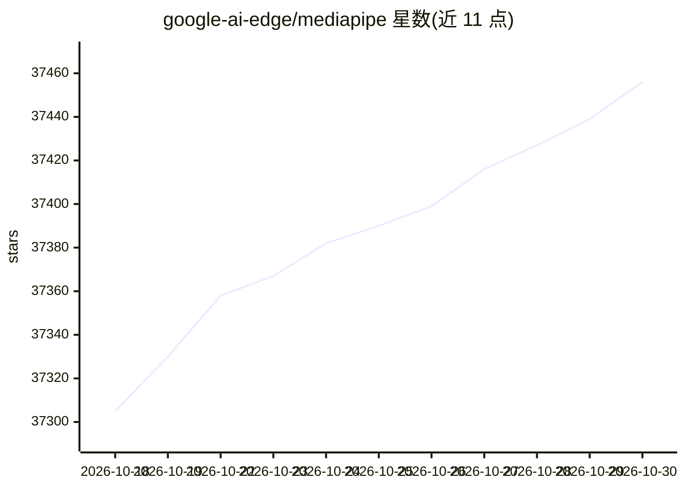

# google-ai-edge/mediapipe

⭐ 37,456 · C++ · Apache-2.0 · 推送 2026-10-29 · [GitHub](https://github.com/google-ai-edge/mediapipe) · [官网](https://ai.google.dev/edge/mediapipe) · 组织维护

**面向开发者的跨端设备机器学习方案库**

MediaPipe 是 Google 维护的开源项目，提供面向移动（Android/iOS）、Web、桌面、边缘设备与 IoT 的端侧机器学习库与工具。包含 MediaPipe Tasks 跨平台 API、预训练模型、Model Maker 模型定制工具与 Studio 浏览器端可视化评估工具；底层 Framework 以 Packets/Graphs/Calculators 概念构建端侧 ML 管线。README 已迁移至 developers.google.com 作为主文档站。Legacy Solutions 自 2023 年 3 月起终止支持，代码与二进制按原样提供。

## 筛选速览

| 维度 | 判定 | 备注 |
|---|---|---|
| AI 角色 | `ai-ecosystem` | LLM/agent 周边工具 |
| 许可风险 | `permissive` | Apache-2.0 |
| 部署形态 | `None` |  |
| 模型依赖 | — | README 未给出锁定关系 |
| 硬件要求 | — | 无带数字的原话,不猜 |
| 安装摩擦 | `low` | 无编译、无系统依赖或容器化 |
| 成熟度 | `idea` | |

## 动量与使用信号

- 维护:`active` — 距上次 push 1.5 天,年发版 6,109 位贡献者
- 涨星:近 1 天 **+5**(自 20261016 起算)
- 安装:github 包 `release-assets` 月下载无数据
- 平台:ANDROID / IOS · 协议:—

## 能力要点

- MediaPipe Tasks 提供跨平台部署 API 与库
- 提供各方案预训练、可直接运行的模型
- Model Maker 支持用自有数据定制模型
- Framework 以图（Graphs）与计算器（Calculators）构建端侧管线

## 适用场景

- 在 Android/iOS/Web/桌面应用中集成视觉、文本、音频 ML 功能
- 在不上传数据的前提下做端侧推理
- 用自有数据定制预训练模型
- 在浏览器中可视化评估方案性能

## 场景标签

`图像视频处理` `推理引擎` `目标检测` · 领域:感知与多模态

## 证据(README 行号)

> L15: **On-device machine learning for everyone**
> L40: MediaPipe Solutions provides a suite of libraries and tools for you to quickly
> L51: * **MediaPipe Tasks**: Cross-platform APIs and libraries for deploying

## 星数曲线

2026-10-18 37,305 → 2026-10-30 37,456（+151）

---
*卡片 v1 · prompt 1.4 · 生成 2026-10-18 · 置信度 high · 依据 README sha `4e0f95120c39` · [字段定义](../../DATASET.md)*
