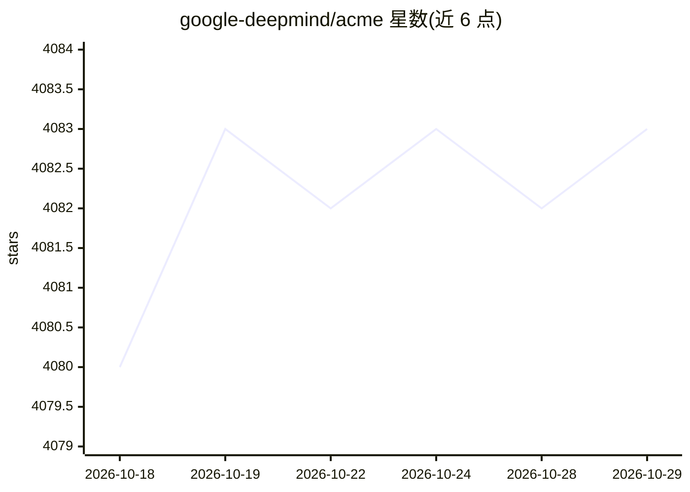

# google-deepmind/acme

⭐ 4,083 · Python · Apache-2.0 · 推送 2026-10-23 · [GitHub](https://github.com/google-deepmind/acme) · 组织维护

**面向研究者的强化学习组件库与基线 Agent 框架**

DeepMind 维护的强化学习研究库：提供可复用构建组件与一批参考实现/基线 Agent，支持单流与分布式两种运行规模，可作为新研究的起点。核心包 dm-acme 可经 pip 安装，运行具体 Agent 需按需加装 JAX 或 TensorFlow 后端，另有 gym、dm_control、bsuite 示例环境与 quickstart/tutorial notebook。README 明确声明这是研究者自用的研究框架，可能出现临时性破坏。

## 筛选速览

| 维度 | 判定 | 备注 |
|---|---|---|
| AI 角色 | `ai-native` | 本体是模型或模型工具 |
| 许可风险 | `permissive` | Apache-2.0 |
| 部署形态 | `library` | 以包/库形式分发 |
| 模型依赖 | — | README 未给出锁定关系 |
| 硬件要求 | — | 无带数字的原话,不猜 |
| 安装摩擦 | `low` | 无编译、无系统依赖或容器化 |
| 成熟度 | `idea` | |

## 能力要点

- 提供参考实现与算法性能基线 Agent
- 支持单流与分布式多规模运行
- 核心包 dm-acme 极简依赖，按需安装 JAX/TensorFlow 后端与示例环境

## 适用场景

- 复用强化学习基线 Agent 做算法性能对比
- 以现有构建组件为起点开展新的 RL 研究
- 在 gym/dm_control/bsuite 环境中快速上手运行 Agent

## 场景标签

`强化学习` · 领域:训练与推理

## 证据(README 行号)

> L8: Acme is a library of reinforcement learning (RL) building blocks that strives to
> L29: > NOTE: Acme is first and foremost a framework for RL research written by
> L83: @article{hoffman2020acme,

## 星数曲线

2026-10-18 4,080 → 2026-10-29 4,083（+3）

---
*卡片 v1 · prompt 1.4 · 生成 2026-10-20 · 置信度 high · 依据 README sha `1850287d61fe` · [字段定义](../../DATASET.md)*
