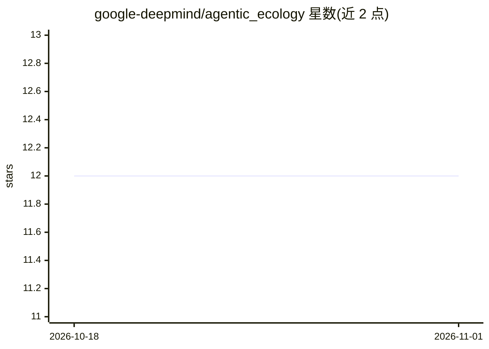

# google-deepmind/agentic_ecology

⭐ 12 · Python · Apache-2.0 · 推送 2026-10-20 · [GitHub](https://github.com/google-deepmind/agentic_ecology) · 组织维护

**生态学（生物声学）数据处理的开源 agent 技能包**

DeepMind 维护的 agentic ecology 项目：为 agentic 开发平台（如 Google Antigravity）提供一套模块化 agent 技能与工作区配置，辅助研究人员与从业者处理、分析、标注被动声学监测（PAM）数据集。演示流程中 agent 下载音频数据、运行 Perch 2.0 模型建立音频索引、生成可浏览/搜索/标注的 Web 应用。仓库本身极简，仅包含依赖配置、工作区指南与人类可读的能力指令，自称'tool-building tool'。

## 筛选速览

| 维度 | 判定 | 备注 |
|---|---|---|
| AI 角色 | `ai-ecosystem` | LLM/agent 周边工具 |
| 许可风险 | `permissive` | Apache-2.0 |
| 部署形态 | `library` | 以包/库形式分发 |
| 模型依赖 | — | README 未给出锁定关系 |
| 硬件要求 | — | 无带数字的原话,不猜 |
| 安装摩擦 | `low` | 无编译、无系统依赖或容器化 |
| 成熟度 | `idea` | |

## 能力要点

- 提供 agentic-ecology-init 技能，通过 npx skills 全局安装
- 演示流程覆盖音频下载、Perch 2.0 嵌入索引、向量库与 Web 标注应用生成
- 技能为模块化人类可读指令，可由用户迭代修改与扩展
- 当前聚焦被动声学监测（生物声学）数据集

## 适用场景

- 借助 agent 为 PAM 数据集构建浏览、搜索与标注的 Web 应用
- 针对特定鸟类鸣声（如 Hooded Warbler）检索音频数据集
- 按自身需求让 agent 定制生态学数据分析工具

## 场景标签

`数据分析` · 领域:效率与自动化

## 证据(README 行号)

> L5: Agentic ecology provides AI-driven tools to assist researchers and practitioners
> L6: processing, analyzing, and annotating their data. It currently focuses on
> L7: passive acoustic monitoring (PAM) datasets (bioacoustics), with more

## 星数曲线

2026-10-18 12 → 2026-11-01 12（+0）

---
*卡片 v1 · prompt 1.4 · 生成 2026-11-01 · 置信度 high · 依据 README sha `b0076aef1e5d` · [字段定义](../../DATASET.md)*
