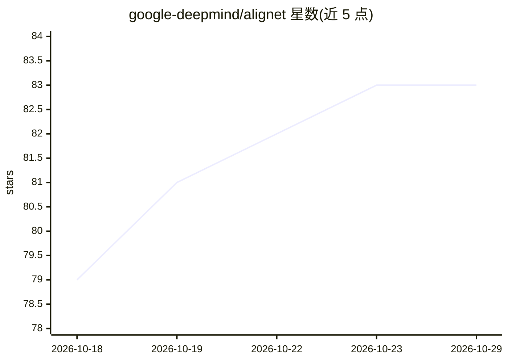

# google-deepmind/alignet

⭐ 83 · Python · Apache-2.0 · 推送 2025-12-01 · [GitHub](https://github.com/google-deepmind/alignet) · 组织维护

**对齐机器与人类视觉表征的训练代码、数据集与模型检查点**

DeepMind 论文 "Aligning Machine and Human Visual Representations across Abstraction Levels" 的配套仓库：包含 AligNet 数据集（1000 万条基于 ImageNet2012 的图像三元组及 odd-one-out 人类相似性判断）、在 SigLIP 预训练模型上微调的代码（基于 Kauldron/TFDS），以及 8 个模型（SigLIP/DINOv2/CLIP 等）各三变体的 Tensorflow SavedModel 检查点。运行微调需手动下载约 150GB 的 ImageNet2012 源数据并在 image-net.org 注册。面向视觉表征学习研究者。

## 筛选速览

| 维度 | 判定 | 备注 |
|---|---|---|
| AI 角色 | `ai-native` | 本体是模型或模型工具 |
| 许可风险 | `permissive` | Apache-2.0 |
| 部署形态 | `library` | 以包/库形式分发 |
| 模型依赖 | — | README 未给出锁定关系 |
| 硬件要求 | — | 无带数字的原话,不猜 |
| 安装摩擦 | `low` | 无编译、无系统依赖或容器化 |
| 成熟度 | — | 结构信号不足 |

## 能力要点

- AligNet 数据集：10M 训练三元组 + 10k 验证三元组，Numpy npz 格式
- SigLIP 微调代码，通过 python -m kauldron.main 运行
- 8 个模型 × 3 变体（base/alignet/untransformed）的 Tensorflow SavedModel 检查点
- 附加 Levels 人类相似性判断评测数据集链接

## 适用场景

- 研究神经网络表征与人类语义认知的对齐
- 下载 AligNet 数据集复现论文微调实验
- 获取经人类相似性判断后训练的视觉模型检查点用于对比实验

## 场景标签

`微调` · 领域:训练与推理

## 证据(README 行号)

> L3: This repository contains code and dataset information for "Aligning Machine and Human Visual Representations across 
> L42: The AligNet dataset is a synthetically generated dataset of image triplets
> L155: We have exported AligNet post-trained versions of several models, which are

## 星数曲线

2026-10-18 79 → 2026-10-29 83（+4）

---
*卡片 v1 · prompt 1.4 · 生成 2026-10-24 · 置信度 mid · 依据 README sha `31de39a80957` · [字段定义](../../DATASET.md)*
