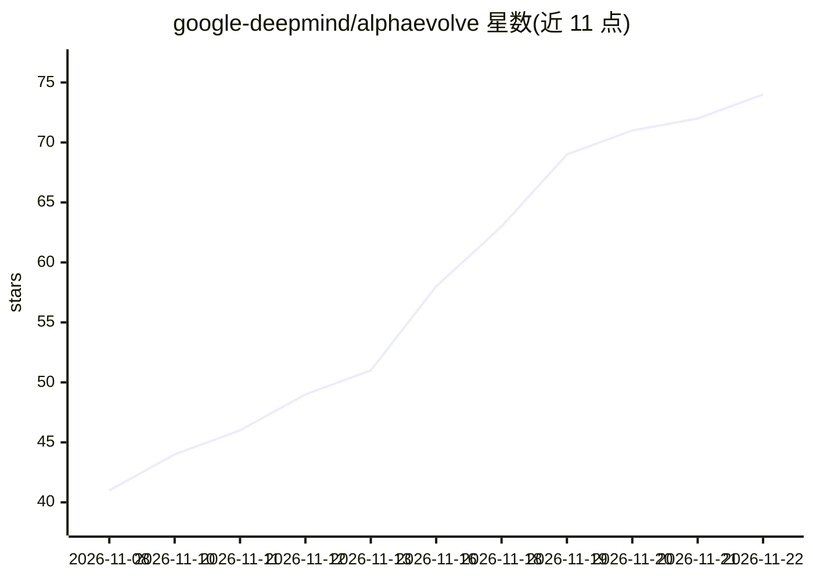

# google-deepmind/alphaevolve

⭐ 74 · Jupyter Notebook · Apache-2.0 · 推送 2026-11-11 · [GitHub](https://github.com/google-deepmind/alphaevolve) · 组织维护

**DeepMind 的算法与科学发现编码 Agent 论文代码**

随论文发布的 AlphaEvolve 仓库：/src 提供带本地评估的最小实现，用 Gemini API 密钥驱动，通过 Docker 沙箱执行 LLM 生成并进化的代码；/omega 收录矩阵乘法指数新上界的 JAX/Haiku 梯度优化程序与 NumPy/SciPy 验证器；/maths 覆盖圆填装、Heilbronn、kissing numbers 等数学问题的初始程序、发现结果与验证；/matmul_tensor_decompositions 提供张量分解 Colab。多数验证笔记本无需安装即可在 Google Colab 运行。README 明确警告 LLM 生成代码不可预测，须视为不可信代码。

## 筛选速览

| 维度 | 判定 | 备注 |
|---|---|---|
| AI 角色 | `ai-native` | 本体是模型或模型工具 |
| 许可风险 | `permissive` | Apache-2.0 |
| 部署形态 | `self-host` | docker 或自建部署 |
| 模型依赖 | — | README 未给出锁定关系 |
| 硬件要求 | — | 无带数字的原话,不猜 |
| 安装摩擦 | `low` | 无编译、无系统依赖或容器化 |
| 成熟度 | — | 结构信号不足 |

## 能力要点

- 进化式编码 Agent 的最小实现，支持本地评估（run.py + YAML 问题配置）
- 矩阵乘法指数新上界的梯度优化程序与有理数算术严格验证笔记本
- 覆盖圆填装、Heilbronn、kissing numbers 等 15 类数学问题的结果与 Colab 验证
- LLM 生成代码在 Docker 沙箱中隔离执行

## 适用场景

- 复现论文中的数学发现与矩阵乘法上界结果
- 基于 /src 最小实现运行自己的 AlphaEvolve 进化实验
- 在 Colab 中验证各数学问题的构造与正确性

## 场景标签

`编码 Agent` `科研工具` · 领域:编码与开发

## 证据(README 行号)

> L5: *AlphaEvolve: A coding agent for scientific and algorithmic discovery*.
> L9: - `/src` contains a minimal implementation of AlphaEvolve with local evaluation.
> L147: **DISCLAIMER:** AlphaEvolve involves the execution of code generated by Large
> L148: Language Models (LLMs). LLM-generated code is intrinsically unpredictable and

## 星数曲线

2026-11-08 41 → 2026-11-22 74（+33）

---
*卡片 v1 · prompt 1.4 · 生成 2026-11-18 · 置信度 mid · 依据 README sha `af2337ae0913` · [字段定义](../../DATASET.md)*
