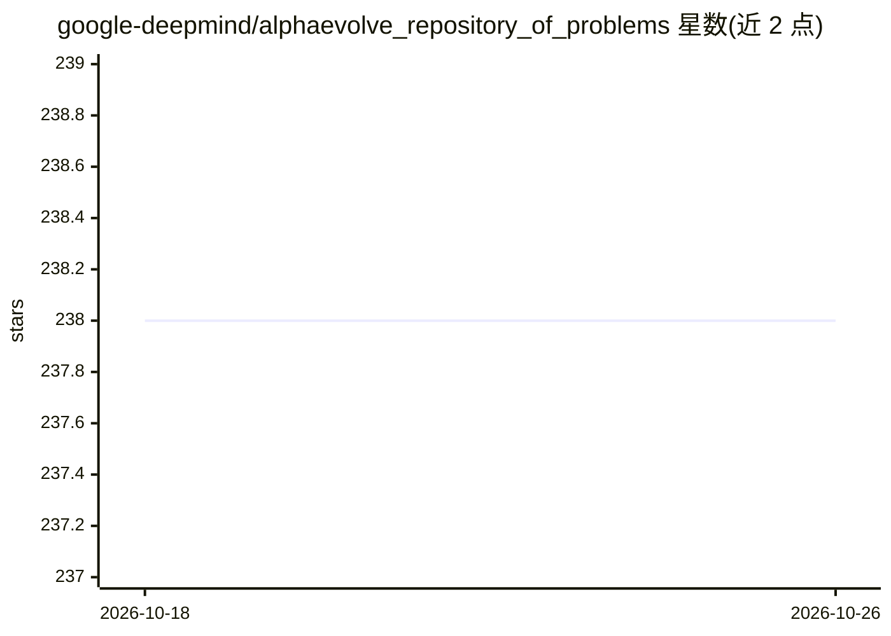

# google-deepmind/alphaevolve_repository_of_problems

⭐ 238 · Jupyter Notebook · Apache-2.0 · 推送 2026-07-11 · [GitHub](https://github.com/google-deepmind/alphaevolve_repository_of_problems) · 组织维护

**AlphaEvolve 论文配套的 67 个数学问题仓库（网页+Colab 笔记本）**

伴随论文《Mathematical exploration and discovery at scale》（Georgiev、Gómez-Serrano、Tao、Wagner，2025，arXiv:2511.02864）发布的数学问题资料库：收录 67 个数学问题，每个问题对应一个 GitHub Pages 网页，多数问题附 Google Colab 笔记本，内含提示词、验证代码、初始程序、演化后的最终程序及可视化/分析代码。仓库不含运行 AlphaEvolve 本身的代码。无需安装，笔记本在 Colab 中打开运行，网页可用浏览器访问。

## 筛选速览

| 维度 | 判定 | 备注 |
|---|---|---|
| AI 角色 | `ai-knowledge` | 知识聚合/清单类 |
| 许可风险 | `permissive` | Apache-2.0 |
| 部署形态 | `None` |  |
| 模型依赖 | — | README 未给出锁定关系 |
| 硬件要求 | — | 无带数字的原话,不猜 |
| 安装摩擦 | `low` | 无编译、无系统依赖或容器化 |
| 成熟度 | — | 结构信号不足 |

## 能力要点

- 67 个数学问题，每个有对应问题描述网页
- 多个 Colab 笔记本含提示词、验证代码与最终演化程序
- 明确声明不含 AlphaEvolve 运行代码
- 以 GitHub Pages 网页形式发布问题状态与结果分布

## 适用场景

- 查看 AlphaEvolve 实验所用的数学问题与最终演化程序
- 在 Colab 中复现或查看验证代码与结果分析
- 了解演化式程序搜索在数学问题上的实验设置

## 场景标签

 · 领域:数学/AI 科研资料

## 证据(README 行号)

> L10: contains the prompt, verification code, and initial program used to launch the
> L14: This repository does *not* contain the code to run AlphaEvolve.
> L18: The repository currently contains 67 mathematical problems whose descriptions

## 星数曲线

2026-10-18 238 → 2026-10-26 238（+0）

---
*卡片 v1 · prompt 1.4 · 生成 2026-10-22 · 置信度 high · 依据 README sha `99a54f6d780a` · [字段定义](../../DATASET.md)*
