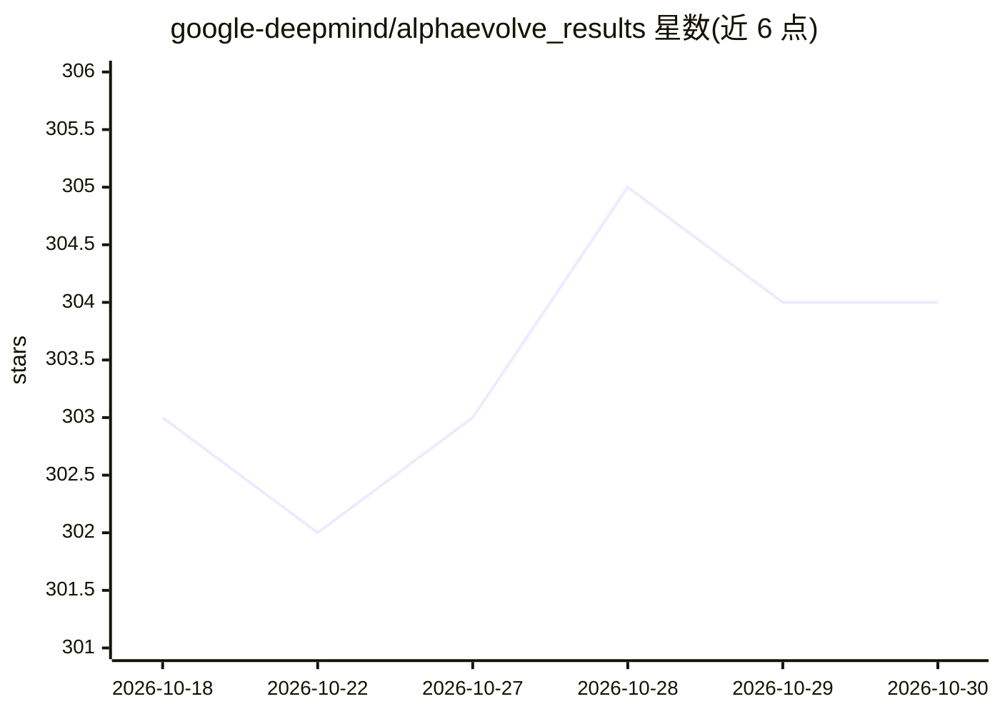

# google-deepmind/alphaevolve_results

⭐ 304 · Jupyter Notebook · Apache-2.0 · 推送 2026-01-05 · [GitHub](https://github.com/google-deepmind/alphaevolve_results) · 组织维护

**AlphaEvolve 数学发现结果与验证代码的配套仓库**

DeepMind 技术报告的配套仓库：包含一个 Google Colab 笔记本，呈现 AlphaEvolve 在数学与算法发现中优于已知最优构造的结果（论文第 3 节），并为每个问题提供验证正确性的代码。仅收录超越先前最优的实例，未超越的案例被排除。仓库不包含运行 AlphaEvolve 本身的代码，无需安装，直接在 Colab 中打开运行即可。

## 筛选速览

| 维度 | 判定 | 备注 |
|---|---|---|
| AI 角色 | `ai-knowledge` | 知识聚合/清单类 |
| 许可风险 | `permissive` | Apache-2.0 |
| 部署形态 | `None` |  |
| 模型依赖 | — | README 未给出锁定关系 |
| 硬件要求 | — | 无带数字的原话,不猜 |
| 安装摩擦 | `low` | 无编译、无系统依赖或容器化 |
| 成熟度 | — | 结构信号不足 |

## 能力要点

- Colab 笔记本按数学问题分节展示 AlphaEvolve 的发现
- 每个发现附带正确性验证代码
- 只收录超越已知最优构造的实例

## 适用场景

- 查阅 AlphaEvolve 的数学发现结果并复现验证
- 引用或跟进 AlphaEvolve 论文的后续研究

## 场景标签

`科研工具` · 领域:学习与行业

## 证据(README 行号)

> L9: Specifically, the repository contains a Google Colab notebook with the
> L19: This repository does *not* contain the code to run AlphaEvolve.

## 星数曲线

2026-10-18 303 → 2026-10-30 304（+1）

---
*卡片 v1 · prompt 1.4 · 生成 2026-10-21 · 置信度 high · 依据 README sha `9aab2b97ebfe` · [字段定义](../../DATASET.md)*
