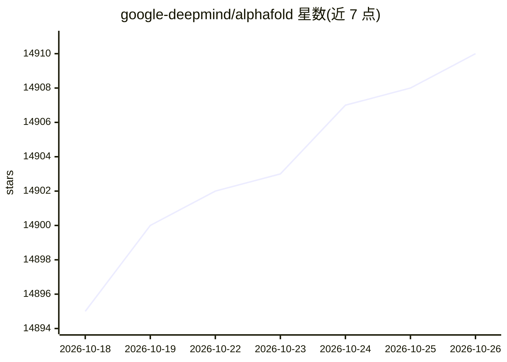

# google-deepmind/alphafold

⭐ 14,910 · Python · Apache-2.0 · 推送 2026-04-22 · [GitHub](https://github.com/google-deepmind/alphafold) · 组织维护

**为科研人员提供蛋白质结构预测 AlphaFold2 推理代码**

DeepMind 开源的 AlphaFold v2 推理流水线实现，读取 FASTA 格式的蛋白序列，输出预测的蛋白质结构。附带 AlphaFold-Multimer（多链复合物预测）实现、v2.3.0 技术说明与 CASP15 基线预测。运行依赖 Linux、Docker、NVIDIA GPU，需下载约 556 GB（解压 2.62 TB）的遗传数据库与模型参数；模型参数以 CC BY 4.0 授权，代码为 Apache 2.0。代码发布使用，发表成果需引用相应论文。

## 筛选速览

| 维度 | 判定 | 备注 |
|---|---|---|
| AI 角色 | `ai-enhanced` | 去掉 AI 部分产品仍成立 |
| 许可风险 | `dual` | Apache-2.0 |
| 部署形态 | `self-host` | docker 或自建部署 |
| 模型依赖 | — | README 未给出锁定关系 |
| 硬件要求 | — | 无带数字的原话,不猜 |
| 安装摩擦 | `low` | 无编译、无系统依赖或容器化 |
| 成熟度 | — | 结构信号不足 |

## 动量与使用信号

- 维护:`maintenance` — 距上次 push 178.6 天,年发版 0,21 位贡献者
- 涨星:近 1 天 **+6**(自 20261016 起算)
- 安装:pypi 包 `docker` 月下载 129,892,206
- 平台:LINUX · 协议:—

## 能力要点

- 提供 AlphaFold2 单体与 AlphaFold-Multimer 推理流水线
- 提供 monomer/casp14/ptm/multimer 等多种 model_preset
- 附下载脚本统一获取遗传数据库与模型参数
- 支持 --gpu_devices、--max_template_date、reduced_dbs 等运行参数

## 适用场景

- 预测蛋白质的三维结构
- 预测蛋白复合物（AlphaFold-Multimer）
- 在受控模板日期下复现 CASP14/15 基线预测

## 场景标签

 · 领域:生命科学/计算生物学

## 证据(README 行号)

> L5: This package provides an implementation of the inference pipeline of AlphaFold
> L40: You will need a machine running Linux, AlphaFold does not support other
> L42: genetic databases (SSD storage is recommended) and a modern NVIDIA GPU (GPUs
> L289: **The simplest way to run AlphaFold is using the provided Docker script.** This

## 星数曲线

2026-10-18 14,895 → 2026-10-26 14,910（+15）

---
*卡片 v1 · prompt 1.4 · 生成 2026-10-18 · 置信度 mid · 依据 README sha `0debb7a95289` · [字段定义](../../DATASET.md)*
