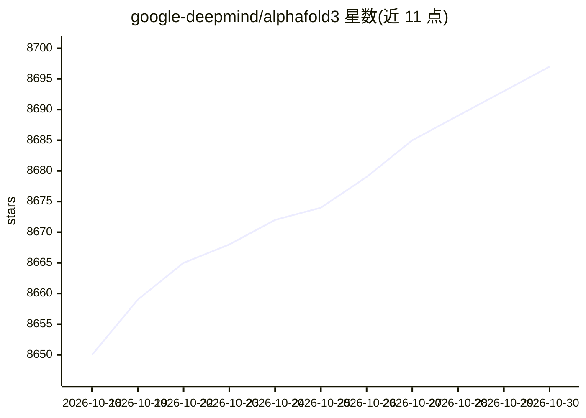

# google-deepmind/alphafold3

⭐ 8,697 · Python · Apache-2.0 · 推送 2026-10-29 · [GitHub](https://github.com/google-deepmind/alphafold3) · 组织维护

**给结构生物学研究者：预测蛋白质及生物分子相互作用的推断管线**

AlphaFold 3 推断管线的官方实现：输入 JSON 描述的序列（蛋白质/配体等），经数据管线（基因与模板搜索，仅 CPU）与模型推断（需 GPU）输出生物分子复合物结构预测。模型参数需单独从 Google 下载并受其使用条款约束；另提供 SynthID Bio-structure 水印版与 Leaving Atom 微调版参数。通过 Docker 运行，源码 Apache 2.0，参数条款独立；声明不用于临床用途。

## 筛选速览

| 维度 | 判定 | 备注 |
|---|---|---|
| AI 角色 | `ai-native` | 本体是模型或模型工具 |
| 许可风险 | `permissive` | Apache-2.0 |
| 部署形态 | `self-host` | docker 或自建部署 |
| 模型依赖 | — | README 未给出锁定关系 |
| 硬件要求 | — | 无带数字的原话,不猜 |
| 安装摩擦 | `low` | 无编译、无系统依赖或容器化 |
| 成熟度 | — | 结构信号不足 |

## 能力要点

- 推断管线分 CPU 数据管线与 GPU 推断两部分，可用 flag 分开运行
- 模型参数需从 Google 下载，受单独使用条款约束
- 提供 SynthID 水印版与 Leaving Atom 微调版两组替代参数
- 镜像并部分内置 BFD/PDB/UniProt 等参考数据库

## 适用场景

- 本地运行蛋白质及分子复合物结构预测
- 复现论文中的 AlphaFold 3 推断结果
- 生成带 SynthID 水印的结构用于来源识别研究

## 场景标签

 · 领域:计算生物学/结构预测

## 证据(README 行号)

> L5: This package provides an implementation of the inference pipeline of
> L32: This repository contains all necessary code for AlphaFold 3 inference. You can
> L81: * `--run_inference` (defaults to `true`): whether to run the inference. This

## 星数曲线

2026-10-18 8,650 → 2026-10-30 8,697（+47）

---
*卡片 v1 · prompt 1.4 · 生成 2026-10-20 · 置信度 high · 依据 README sha `756d0b9c213f` · [字段定义](../../DATASET.md)*
