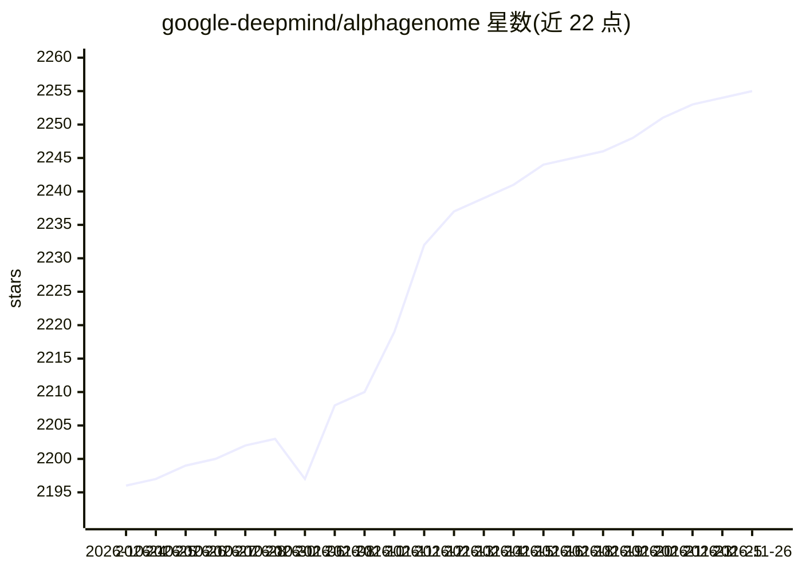

# google-deepmind/alphagenome

⭐ 2,255 · Python · Apache-2.0 · 推送 2026-11-24 · [GitHub](https://github.com/google-deepmind/alphagenome) · [官网](https://www.alphagenomedocs.com) · 组织维护

**给基因组研究者提供 AlphaGenome 模型的 Python API 访问**

google-deepmind 发布的 Python 包，通过 API 程序化访问 AlphaGenome 系列模型：AlphaGenome 2 多模态 DNA 序列模型、AlphaGenome Atlas（90 亿人类变异的预计算变异效应评分）及 AlphaGenome 1。用户可通过 API 进行预测、变异评分、表达条件化等操作。非商业用途免费，查询速率随需求变化，实时预测适合小规模分析；商业用途需经 Google Cloud。输出仅限研究用途，明确不可用于临床决策。

## 筛选速览

| 维度 | 判定 | 备注 |
|---|---|---|
| AI 角色 | `ai-native` | 本体是模型或模型工具 |
| 许可风险 | `permissive` | Apache-2.0 |
| 部署形态 | `library` | 以包/库形式分发 |
| 模型依赖 | — | README 未给出锁定关系 |
| 硬件要求 | — | 无带数字的原话,不猜 |
| 安装摩擦 | `low` | 无编译、无系统依赖或容器化 |
| 成熟度 | — | 结构信号不足 |

## 能力要点

- 程序化访问 AlphaGenome 2/1 与 Atlas 三类模型资源
- Atlas 提供约 90 亿人类变异的预计算变异效应与 AVI 评分
- 预测、变异评分、scRNA-seq 表达条件化等 API 工作流
- 提供 Colab 教程、用户指南与端到端分析 vignettes

## 适用场景

- 对基因组变异做效应评分与调控活性预测
- 用自有 scRNA-seq 数据做表达条件化分析
- 通过 Atlas API 查询预计算的非编码变异影响

## 场景标签

`科研工具` · 领域:学习与行业

## 证据(README 行号)

> L15: The `alphagenome` package provides programmatic access to the AlphaGenome family
> L32: The API is offered free of charge for
> L96: For example, to score a variant with AlphaGenome 2:

## 星数曲线

2026-10-24 2,196 → 2026-11-26 2,255（+59）

---
*卡片 v1 · prompt 1.4 · 生成 2026-11-26 · 置信度 high · 依据 README sha `0b06b6656604` · [字段定义](../../DATASET.md)*
