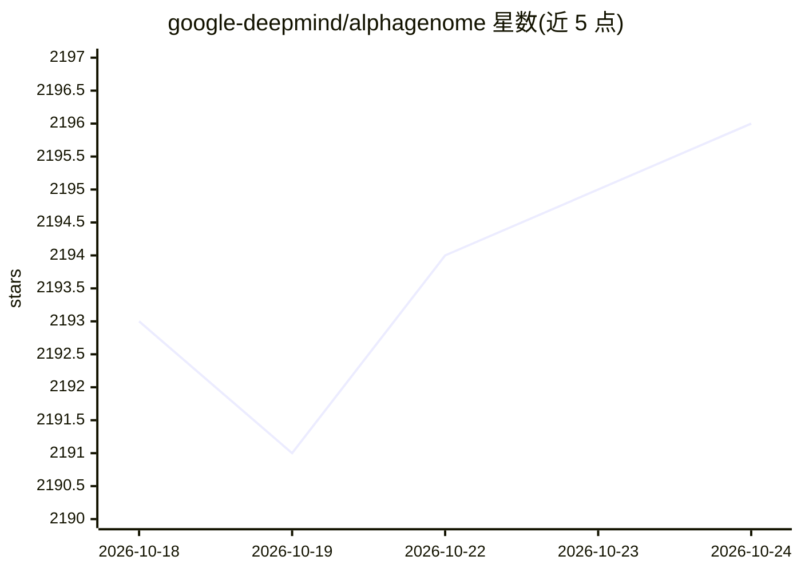

# google-deepmind/alphagenome

⭐ 2,197 · Python · Apache-2.0 · 推送 2026-10-15 · [GitHub](https://github.com/google-deepmind/alphagenome) · [官网](https://www.alphagenomedocs.com) · 组织维护

**DeepMind DNA 调控预测模型 AlphaGenome 的 Python API 客户端**

Google DeepMind 官方提供的 AlphaGenome API 客户端库、示例与文档：通过 API key 调用 AlphaGenome 模型，对最长 100 万碱基对的 DNA 序列输出基因表达、剪接、染色质特征、接触图等多模态预测，多数输出达单碱基分辨率；并提供覆盖全人类基因组的预计算变异效应数据集 Atlas（AVI 分数、特征重要性）。非商业用途免费，输出仅限理论研究、不得用于临床决策；商业使用需经 Google Cloud。附带 Colab 快速入门 notebook 与可视化库。

## 筛选速览

| 维度 | 判定 | 备注 |
|---|---|---|
| AI 角色 | `ai-native` | 本体是模型或模型工具 |
| 许可风险 | `permissive` | Apache-2.0 |
| 部署形态 | `library` | 以包/库形式分发 |
| 模型依赖 | — | README 未给出锁定关系 |
| 硬件要求 | — | 无带数字的原话,不猜 |
| 安装摩擦 | `low` | 无编译、无系统依赖或容器化 |
| 成熟度 | — | 结构信号不足 |

## 能力要点

- 对最长 1Mb DNA 序列的多模态预测（表达/剪接/染色质/接触图）
- 多数输出达单碱基分辨率，覆盖变异效应预测任务
- Atlas 全基因组预计算变异效应分数（AVI）与特征重要性
- 提供 matplotlib 可视化库与 Colab 入门 notebook

## 适用场景

- 预测基因组区域的基因表达与剪接等调控输出
- 对非编码变异做变异效应打分与优先级排序
- 在 Colab 中快速运行入门示例并可视化预测结果

## 场景标签

 · 领域:生物信息学/基因组学

## 证据(README 行号)

> L15: The AlphaGenome API provides access to AlphaGenome, Google DeepMind’s unifying
> L20: AlphaGenome offers multimodal predictions, encompassing diverse functional
> L23: sequences of up to 1 million base pairs in length and can deliver predictions at

## 星数曲线

2026-10-18 2,193 → 2026-10-24 2,196（+3）

---
*卡片 v1 · prompt 1.4 · 生成 2026-10-21 · 置信度 mid · 依据 README sha `97e5a1048794` · [字段定义](../../DATASET.md)*
