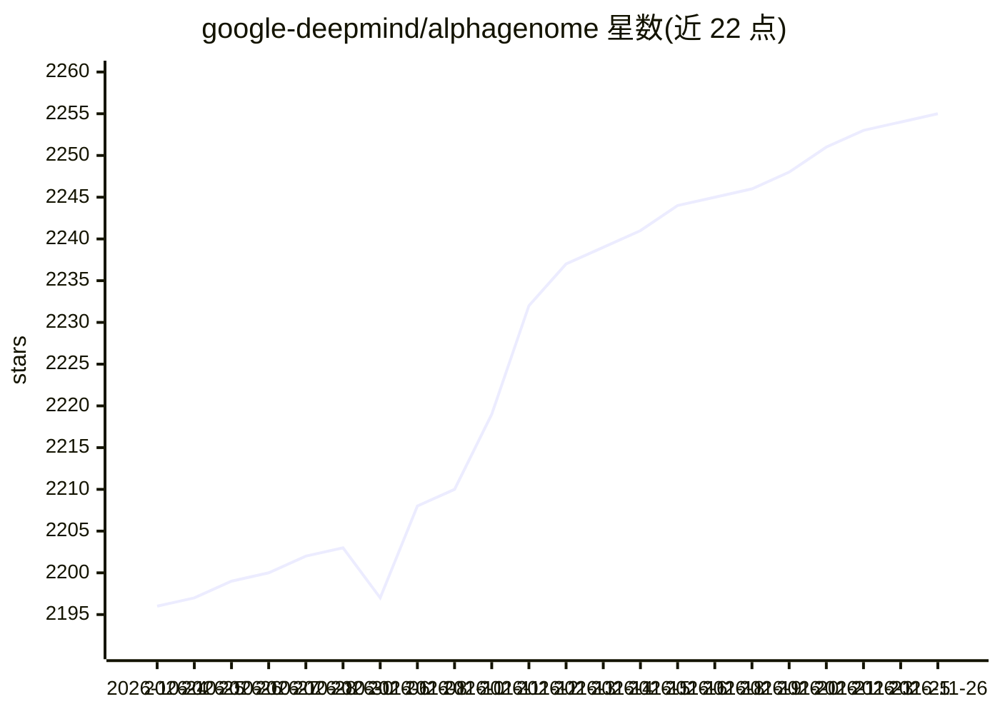

# google-deepmind/alphagenome

⭐ 2,255 · Python · Apache-2.0 · 推送 2026-11-24 · [GitHub](https://github.com/google-deepmind/alphagenome) · [官网](https://www.alphagenomedocs.com) · 组织维护

**科研人员调用 AlphaGenome 模型的 Python API 客户端**

alphagenome 包以 PyPI 分发，为 Google DeepMind 的 AlphaGenome 系列模型与 AlphaGenome Atlas 提供程序化访问：可运行 DNA 序列预测、变异效应评分、基于自身 scRNA-seq 数据的表达条件化，以及查询 Atlas 预计算的 90 亿人类变异变异效应分数。API 免费供非商业用途，查询速率随负载变化，实时预测适合小规模分析；商业使用需经 Google Cloud。预测仅限理论建模与研究，禁止用于临床决策。

## 筛选速览

| 维度 | 判定 | 备注 |
|---|---|---|
| AI 角色 | `ai-native` | 本体是模型或模型工具 |
| 许可风险 | `permissive` | Apache-2.0 |
| 部署形态 | `library` | 以包/库形式分发 |
| 模型依赖 | — | README 未给出锁定关系 |
| 硬件要求 | — | 无带数字的原话,不猜 |
| 安装摩擦 | `low` | 无编译、无系统依赖或容器化 |
| 成熟度 | — | 结构信号不足 |

## 能力要点

- 访问 AlphaGenome 2 多模态 DNA 序列模型，支持表达条件化与跨 1Mb 序列的模态插补
- 查询 AlphaGenome Atlas 90 亿人类变异的预计算变异效应分数与 AVI 分数
- 提供 Colab 教程、用户指南、端到端生物分析案例与完整 API 参考
- 非商业用途免费，商业使用经 Google Cloud 提供

## 适用场景

- 对基因组变异做 in silico 变异效应评分以辅助非编码变异解读
- 用自有 scRNA-seq 数据做表达条件化预测
- 在 Colab 笔记本中跟教程学习变异评分与可视化流程

## 场景标签

`科研工具` · 领域:学习与行业

## 证据(README 行号)

> L15: The `alphagenome` package provides programmatic access to the AlphaGenome family
> L18: - **AlphaGenome 2**: Our latest multimodal DNA sequence model, with improved
> L31: demand: pre-computed Atlas lookups support higher query rates than live model

## 星数曲线

2026-10-24 2,196 → 2026-11-26 2,255（+59）

---
*卡片 v1 · prompt 1.4 · 生成 2026-11-23 · 置信度 high · 依据 README sha `183b505e0353` · [字段定义](../../DATASET.md)*
