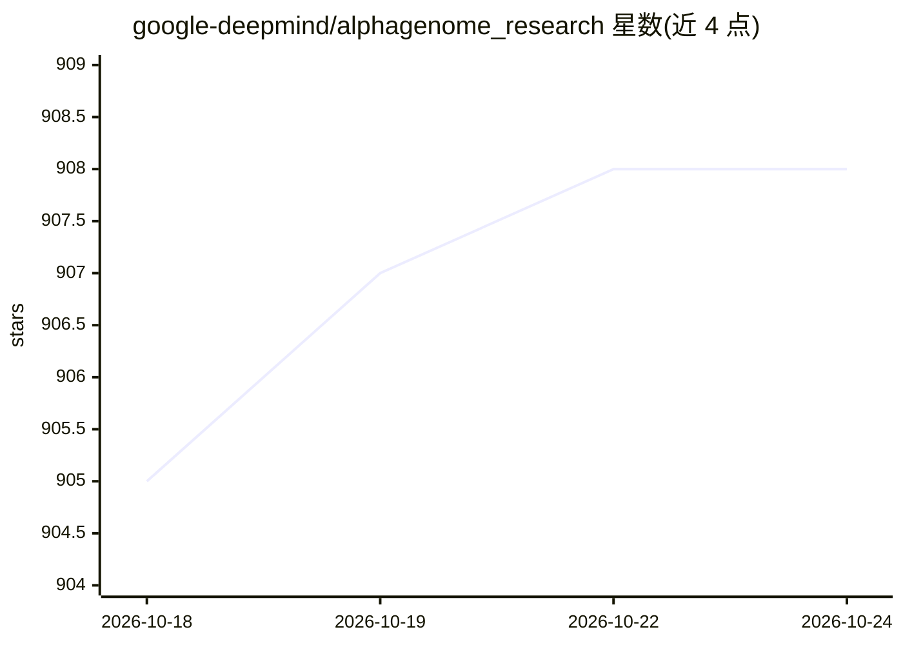

# google-deepmind/alphagenome_research

⭐ 908 · Python · Apache-2.0 · 推送 2026-10-13 · [GitHub](https://github.com/google-deepmind/alphagenome_research) · 组织维护

**面向科研的 AlphaGenome DNA 序列模型研究代码（JAX 实现）**

Google DeepMind 发布的 AlphaGenome 研究代码：提供用 JAX 编写的模型实现、AlphaGenome API 实现与变异评分器、TFRecords 训练数据加载器和 Colab notebooks。模型分析最长 100 万碱基对的 DNA 序列，在基因表达、剪接、染色质特征、接触图等多模态上给出单碱基分辨率预测。预训练权重可从 Kaggle 或 Hugging Face 下载（需接受非商业条款），推理推荐 NVIDIA H100 GPU，训练推荐 TPU v3 及以上。

## 筛选速览

| 维度 | 判定 | 备注 |
|---|---|---|
| AI 角色 | `ai-native` | 本体是模型或模型工具 |
| 许可风险 | `permissive` | Apache-2.0 |
| 部署形态 | `library` | 以包/库形式分发 |
| 模型依赖 | — | README 未给出锁定关系 |
| 硬件要求 | — | 无带数字的原话,不猜 |
| 安装摩擦 | `medium` | 含编译或系统依赖之一 |
| 成熟度 | — | 结构信号不足 |

## 能力要点

- JAX 实现的 AlphaGenome 模型与变异评分器
- 读取 TFRecords 训练数据的 dataset loader
- 支持最长 100 万碱基对、单碱基分辨率的多模态预测
- 预训练权重经 Kaggle / Hugging Face 分发（非商业条款）

## 适用场景

- 在我的研究中本地运行 AlphaGenome 做变异效应预测
- 用预训练权重做 in silico 突变（ISM）与变异评分
- 复现或扩展 AlphaGenome 的训练与评估流程

## 场景标签

`科研工具` · 领域:学习与行业

## 证据(README 行号)

> L13: AlphaGenome is a unified DNA sequence model designed to advance regulatory
> L21: - An implementation of the AlphaGenome model, written in

## 星数曲线

2026-10-18 905 → 2026-10-24 908（+3）

---
*卡片 v1 · prompt 1.4 · 生成 2026-10-21 · 置信度 high · 依据 README sha `aa9ba37d0bd3` · [字段定义](../../DATASET.md)*
