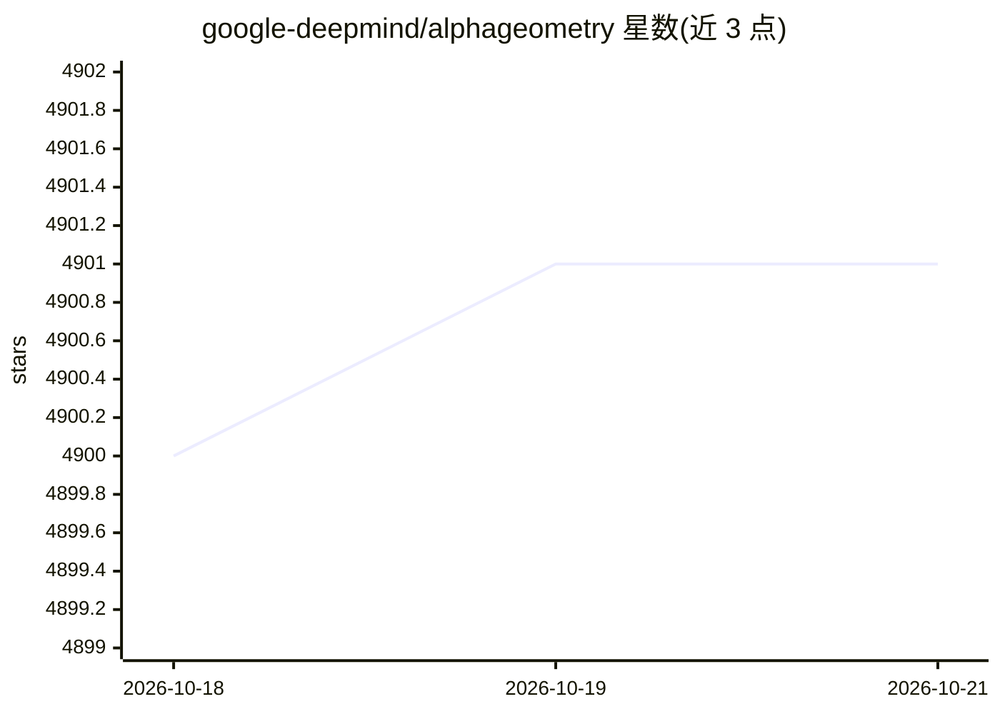

# google-deepmind/alphageometry

⭐ 4,901 · Python · Apache-2.0 · 推送 2026-01-13 · [GitHub](https://github.com/google-deepmind/alphageometry) · 组织维护

**DeepMind 的奥林匹克几何定理证明器（DDAR+AlphaGeometry）官方复现代码**

复现 Nature 2024 论文中 DDAR 与 AlphaGeometry 两个几何定理证明器的研究代码：符号演绎引擎（DD+AR）与在 1 亿合成样本上训练的 150M 参数语言模型结合，由 LM 提议辅助构造、DDAR 完成证明搜索。面向科研人员，提供 IMO-AG-30 与 JGEX-AG-231 问题集及复现实验结果（分别解出 25/30 与 228/231）。复现论文设定需 4 块 V100 GPU 与 250 个 CPU worker；代码已剥离依赖内部基础设施的并行与加速优化。模型权重以 CC BY 4.0 发布，Jan 2026 更新指向 AlphaGeometry2 的 DDAR 代码。

## 筛选速览

| 维度 | 判定 | 备注 |
|---|---|---|
| AI 角色 | `ai-native` | 本体是模型或模型工具 |
| 许可风险 | `permissive` | Apache-2.0 |
| 部署形态 | `library` | 以包/库形式分发 |
| 模型依赖 | — | README 未给出锁定关系 |
| 硬件要求 | — | 无带数字的原话,不猜 |
| 安装摩擦 | `low` | 无编译、无系统依赖或容器化 |
| 成熟度 | — | 结构信号不足 |

## 能力要点

- DDAR 符号引擎与 150M LM 语言模型结合的证明搜索
- 复现论文设定需 4×V100 GPU 与 250 CPU worker
- 提供 IMO-AG-30/JGEX-AG-231 问题集，结果为 25/30 与 228/231
- DDAR 求解器可脱离 LM 与 sentencepiece 依赖独立运行

## 适用场景

- 复现 Nature 2024 论文的几何证明实验结果
- 研究神经符号方法在定理证明中的应用
- 在自定义几何问题集上运行 DDAR 或 AlphaGeometry 求解器

## 场景标签

`科研工具` · 领域:学习与行业

## 证据(README 行号)

> L3: This repository contains the code necessary to
> L6: introduced in the Nature 2024 paper:
> L100: We make use of the `gin` library to manage model configurations,

## 星数曲线

2026-10-18 4,900 → 2026-10-21 4,901（+1）

---
*卡片 v1 · prompt 1.4 · 生成 2026-10-20 · 置信度 high · 依据 README sha `fad1a0fd4e30` · [字段定义](../../DATASET.md)*
