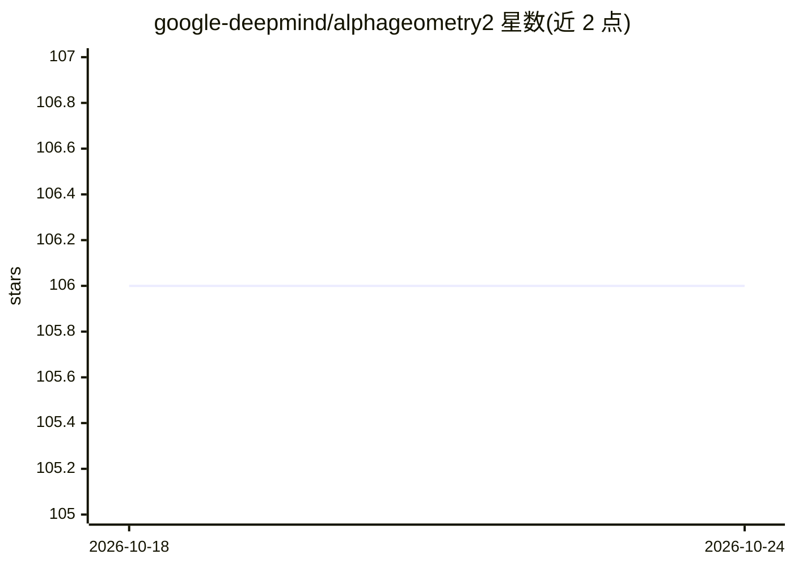

# google-deepmind/alphageometry2

⭐ 106 · Python · Apache-2.0 · 推送 2026-01-07 · [GitHub](https://github.com/google-deepmind/alphageometry2) · 组织维护

**DeepMind 奥数几何求解系统 AlphaGeometry2 的符号引擎 DDAR 复现代码**

Google DeepMind 发布的 AlphaGeometry2 符号引擎 DDAR 的复现代码库。DDAR 在用 AlphaGeometry2 语言形式化并补充点坐标的题目上运行，部分 IMO 题目可由 DDAR 单独求解，另一些需要语言模型提供辅助点。仓库支持复现 IMO 2005 P1、IMO 2008 P6、IMO 2013 P3 等题目。安装需 Python 虚拟环境与 numpy，运行 python -m test 即可在示例题目上执行证明器。AG2 论文已发表于 JMLR。

## 筛选速览

| 维度 | 判定 | 备注 |
|---|---|---|
| AI 角色 | `ai-native` | 本体是模型或模型工具 |
| 许可风险 | `permissive` | Apache-2.0 |
| 部署形态 | `library` | 以包/库形式分发 |
| 模型依赖 | — | README 未给出锁定关系 |
| 硬件要求 | — | 无带数字的原话,不猜 |
| 安装摩擦 | `low` | 无编译、无系统依赖或容器化 |
| 成熟度 | — | 结构信号不足 |

## 能力要点

- 包含 AlphaGeometry2 符号引擎 DDAR 的可运行代码
- 可复现 IMO 2005 P1、IMO 2008 P6、IMO 2013 P3 等题目求解
- 在形式化题目与点坐标输入上运行符号推理

## 适用场景

- 复现 AlphaGeometry2 求解奥数几何题的结果
- 研究符号引擎 DDAR 的推理机制
- 验证 IMO 题目的符号证明过程

## 场景标签

`科研工具` · 领域:学习与行业

## 证据(README 行号)

> L13: This is done by running the symbolic part of AlphaGeometry2 system called DDAR.
> L14: DDAR runs on problems formalized into the AlphaGeometry2 language and
> L15: supplemented by the point coordinates. Some problems can be solved by DDAR

## 星数曲线

2026-10-18 106 → 2026-10-24 106（+0）

---
*卡片 v1 · prompt 1.4 · 生成 2026-10-23 · 置信度 mid · 依据 README sha `f79366d72ce2` · [字段定义](../../DATASET.md)*
