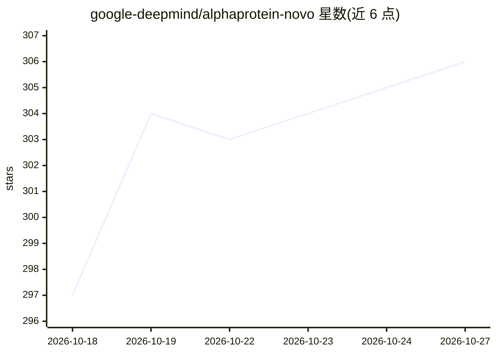

# google-deepmind/alphaprotein-novo

⭐ 306 · Python · Apache-2.0 · 推送 2026-10-06 · [GitHub](https://github.com/google-deepmind/alphaprotein-novo) · 组织维护

**从头酶设计的生成式扩散模型流水线**

DeepMind 发布的酶从头设计工具：扩散模型以催化 motif 和配体环境为条件，联合生成蛋白质结构与序列；可与可选的 LigandMPNN 序列重设计、AlphaFold 3 结构预测及评估指标串联为端到端流水线（run_pipeline.py）。设计任务通过 JSON manifest 配置，支持固定/非固定索引 motif、部分扩散等条件方式。预训练权重不含在包内，需另行从 Google Cloud Storage 下载并受使用条款约束。安装基于 uv/Python 3.12 环境，LigandMPNN 需独立 Python 3.11 环境。

## 筛选速览

| 维度 | 判定 | 备注 |
|---|---|---|
| AI 角色 | `ai-native` | 本体是模型或模型工具 |
| 许可风险 | `permissive` | Apache-2.0 |
| 部署形态 | `None` |  |
| 模型依赖 | — | README 未给出锁定关系 |
| 硬件要求 | — | 无带数字的原话,不猜 |
| 安装摩擦 | `low` | 无编译、无系统依赖或容器化 |
| 成熟度 | — | 结构信号不足 |

## 能力要点

- 扩散模型以催化 motif 与配体为条件联合生成蛋白质结构与序列
- 端到端流水线：生成→LigandMPNN 重设计→AlphaFold 3 折叠→评估
- JSON manifest 配置设计任务，支持部分扩散、unindexed motif 等条件
- 内置 5 类酶评估套件（Kemp 消除酶、丝氨酸酯酶等）

## 适用场景

- 为新反应或非天然底物从头设计酶催化剂
- 以过渡态/中间体 3D motif 为条件生成支架蛋白
- 基于已有设计做部分扩散多样化

## 场景标签

 · 领域:计算生物学/蛋白质设计

## 证据(README 行号)

> L3: AlphaProtein Novo (AP Novo) is a generative diffusion pipeline for *de novo*
> L6: This package includes a diffusion model which co-generates protein structures
> L7: and sequences conditioned on a catalytic motif and ligand context. This is run

## 星数曲线

2026-10-18 297 → 2026-10-27 306（+9）

---
*卡片 v1 · prompt 1.4 · 生成 2026-10-21 · 置信度 high · 依据 README sha `6cfea5726c67` · [字段定义](../../DATASET.md)*
