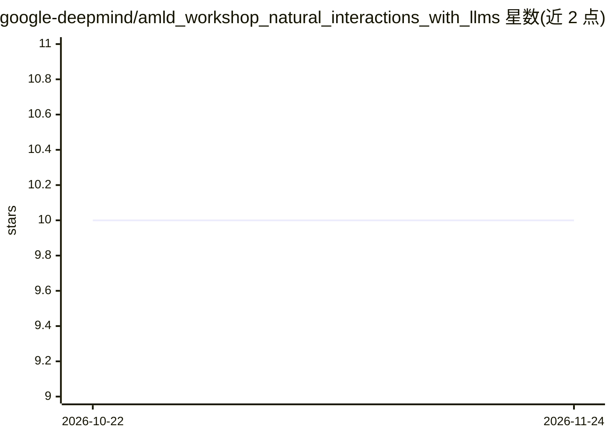

# google-deepmind/amld_workshop_natural_interactions_with_llms

⭐ 10 · Python · Apache-2.0 · 推送 2026-04-17 · [GitHub](https://github.com/google-deepmind/amld_workshop_natural_interactions_with_llms) · 组织维护

**AMLD 研讨会教程：用数字墨水与视觉大模型交互**

DeepMind 发布的 AMLD 2025 研讨会教学代码库：通过 Colab 笔记本演示如何以数字墨水作为与视觉大语言模型交互的方式。内容覆盖三个环节：与微调版 PaliGemma 2 实际交互、通过提示测试新分布外手势的局限、合成生成新手势数据集并微调模型使其习得新能力。加载与微调使用 big_vision 框架，微调用到 DeepWriting、IAM-OnDB 墨水数据与 Wikipedia 文档。

## 筛选速览

| 维度 | 判定 | 备注 |
|---|---|---|
| AI 角色 | `ai-knowledge` | 知识聚合/清单类 |
| 许可风险 | `permissive` | Apache-2.0 |
| 部署形态 | `None` |  |
| 模型依赖 | — | README 未给出锁定关系 |
| 硬件要求 | — | 无带数字的原话,不猜 |
| 安装摩擦 | `low` | 无编译、无系统依赖或容器化 |
| 成熟度 | — | 结构信号不足 |

## 能力要点

- 提供 Colab 笔记本形式的完整实践教程
- 基于微调版 PaliGemma 2 做墨水交互演示
- 包含合成手势数据生成与模型微调环节
- 微调使用 big_vision 框架与 IAM-OnDB 墨水数据

## 适用场景

- 参加 AMLD 研讨会时进行实践环节练习
- 学习如何用数字墨水与视觉大模型交互
- 复现 PaliGemma 2 墨水手势微调流程

## 场景标签

`教程课程` `微调` · 领域:学习与行业

## 证据(README 行号)

> L5: This repository contains the instructions and the code related to the
> L6: AMLD 2025 Workshop on natural interactions
> L18: To load, interact, and fine-tune PaliGemma 2, we will be using the

## 星数曲线

2026-10-22 10 → 2026-11-24 10（+0）

---
*卡片 v1 · prompt 1.4 · 生成 2026-11-19 · 置信度 high · 依据 README sha `a629e0d7423b` · [字段定义](../../DATASET.md)*
