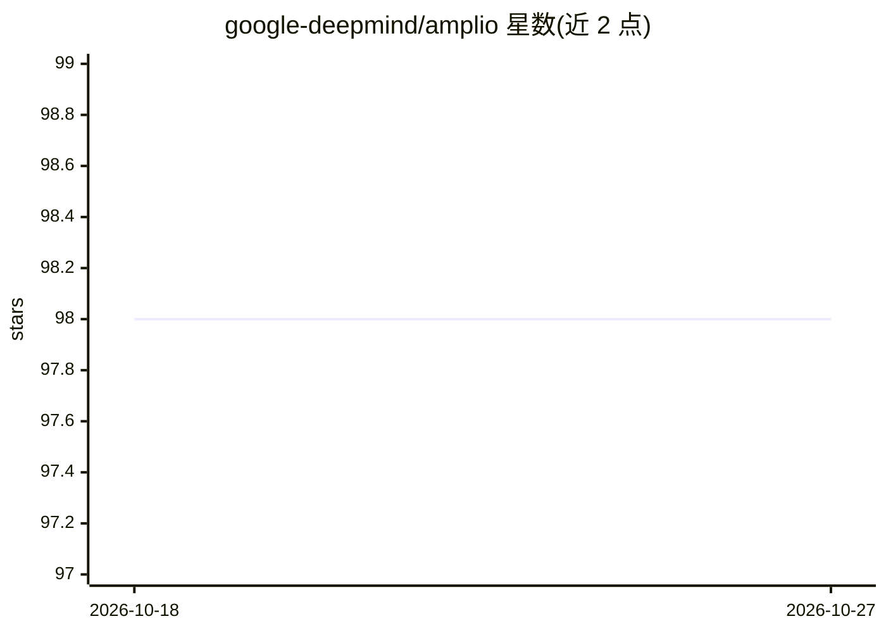

# google-deepmind/amplio

⭐ 98 · Go · Apache-2.0 · 推送 2026-10-23 · [GitHub](https://github.com/google-deepmind/amplio) · 组织维护

**轻量多智能体运行框架：面向长周期任务，崩溃可恢复**

基于简单 step 模型的多智能体框架，agent 通过 shell、文件编辑、子 agent 派生与协调等通用工具执行任务；DB 优先持久化使 agentic loop 任意时刻崩溃均可恢复，子 agent 会话树随服务恢复自动续起。运行需本地数据目录（SQLite）与外部 LLM provider（如 Vertex AI 上的 Gemini/Claude），首次构建下载 130 MB 嵌入模型构建召回表，可用 LOCAL_EMBED=0 跳过。以单一二进制（内嵌前端）分发，需自行用 Go 与 Node.js 22+ 构建。注意：不沙箱 agent 的 shell，以启动用户权限执行命令；读取端口未做门控。

## 筛选速览

| 维度 | 判定 | 备注 |
|---|---|---|
| AI 角色 | `ai-ecosystem` | LLM/agent 周边工具 |
| 许可风险 | `permissive` | Apache-2.0 |
| 部署形态 | `None` |  |
| 模型依赖 | — | README 未给出锁定关系 |
| 硬件要求 | — | 无带数字的原话,不猜 |
| 安装摩擦 | `low` | 无编译、无系统依赖或容器化 |
| 成熟度 | — | 结构信号不足 |

## 能力要点

- step 模型 + DB 优先持久化，崩溃后可从任意点恢复
- 子 agent 会话树随服务恢复自动续起
- 支持自主运行或与用户交互协同驱动
- 内置本地召回表（嵌入模型，可降级为关键词匹配）

## 适用场景

- 运行需要长时间持续执行且中途可能中断的 agent 任务
- 以自主或人机协同方式驱动多 agent 协作完成任务
- 通过内嵌前端或 client/headless 命令使用 agent 服务

## 场景标签

`多智能体` · 领域:Agent 开发

## 证据(README 行号)

> L1: # Amplio: A Lightweight Agent Harness for Robust and Long-Horizon Runs
> L3: * **Lightweight**: Multi-agent framework based on a simple step model that provides natural crash-resume capability,
> L4: * **Robust**: DB-first persistence; crashing at any point during the agentic loop can be robustly resumed.

## 星数曲线

2026-10-18 98 → 2026-10-27 98（+0）

---
*卡片 v1 · prompt 1.4 · 生成 2026-10-23 · 置信度 high · 依据 README sha `cc07c953486b` · [字段定义](../../DATASET.md)*
