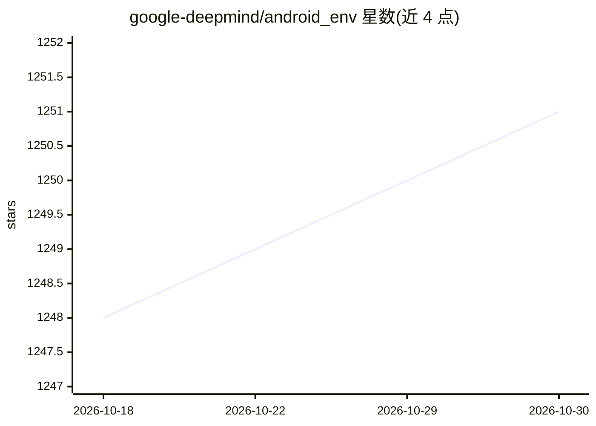

# google-deepmind/android_env

⭐ 1,251 · Python · Apache-2.0 · 推送 2026-10-29 · [GitHub](https://github.com/google-deepmind/android_env) · 组织维护

**面向 Android 设备的 RL 研究与 UI agent 交互平台**

Google DeepMind 维护的 Python/Kotlin 平台，通过 WebSocket 连接设备端 Kotlin Core 服务器，支持模拟器与实体 Android 设备的遥测（截图、无障碍树、日志、传感器）与控制（触摸手势、按键、文本、ADB 命令）。v2 将设备交互与 RL 任务解耦：AndroidDevice 提供直接控制，AndroidEnv/TaskWrapper 叠加 dm_env 的 MDP 语义；另含浏览器版 Playground 工作台。需自备 Android 设备或 AVD，部分构建流程依赖 Bazel。

## 筛选速览

| 维度 | 判定 | 备注 |
|---|---|---|
| AI 角色 | `ai-ecosystem` | LLM/agent 周边工具 |
| 许可风险 | `permissive` | Apache-2.0 |
| 部署形态 | `library` | 以包/库形式分发 |
| 模型依赖 | — | README 未给出锁定关系 |
| 硬件要求 | — | 无带数字的原话,不猜 |
| 安装摩擦 | `low` | 无编译、无系统依赖或容器化 |
| 成熟度 | — | 结构信号不足 |

## 能力要点

- AndroidDevice 直接控制与订阅式遥测（截图/无障碍树/传感器/logcat）
- 可组合 RL 层：dm_env 语义、.textproto 任务、Gymnasium 封装
- Playground 网页工作台支持实时屏幕交互与 ADB 执行
- 支持 Android Studio 模拟器与 USB 实体设备

## 适用场景

- 在真实 Android 系统上训练与评测 RL 智能体
- 基础模型 UI agent 的设备控制与评测
- Android 应用的自动化测试脚本编写

## 场景标签

`强化学习` `GUI 自动化` · 领域:效率与自动化

## 证据(README 行号)

> L5: (both virtualized emulators and physical hardware). Built for foundation model
> L6: UI agents, automated testing, and Reinforcement Learning (RL) research,
> L64: * **Composable RL Layer**: When training RL policies, wrap `AndroidDevice`

## 星数曲线

2026-10-18 1,248 → 2026-10-30 1,251（+3）

---
*卡片 v1 · prompt 1.4 · 生成 2026-10-21 · 置信度 high · 依据 README sha `68ff119ae36e` · [字段定义](../../DATASET.md)*
