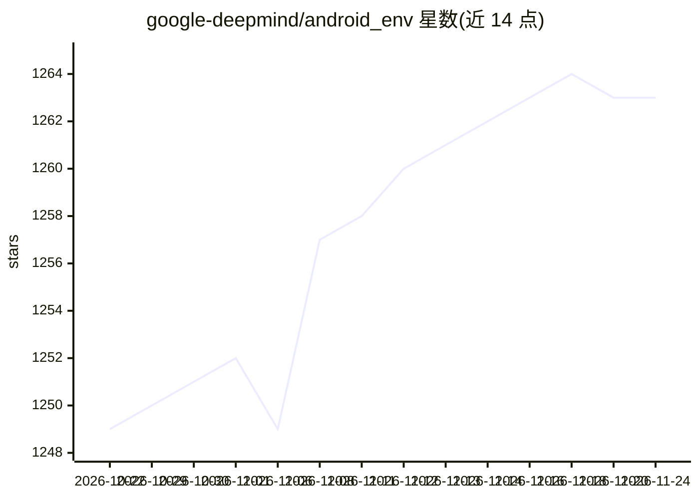

# google-deepmind/android_env

⭐ 1,262 · Python · Apache-2.0 · 推送 2026-11-18 · [GitHub](https://github.com/google-deepmind/android_env) · 组织维护

**面向 Android 设备交互的 RL 与 UI agent 研究平台**

由 Google DeepMind 维护的 Python/Kotlin 平台，用于与 Android 设备（模拟器与物理机）交互：通过设备端 Kotlin Core 服务器以 WebSocket 采集截图、无障碍树、日志与传感器数据，并注入触摸手势、按键、文本与 ADB 命令。v2 将设备交互与 RL 任务解耦：`AndroidDevice` 提供任务无关的设备控制与遥测，`AndroidEnv`/`TaskWrapper` 在其上叠加 dm_env 的 MDP 语义（step/reset/奖励/回合终止）；另提供 Web Playground 与面向 LLM agent 的 MCP 服务器。从 PyPI 安装，或以 Bazel 从源码构建；需要本地 Android SDK。

## 筛选速览

| 维度 | 判定 | 备注 |
|---|---|---|
| AI 角色 | `ai-ecosystem` | LLM/agent 周边工具 |
| 许可风险 | `permissive` | Apache-2.0 |
| 部署形态 | `library` | 以包/库形式分发 |
| 模型依赖 | — | README 未给出锁定关系 |
| 硬件要求 | — | 无带数字的原话,不猜 |
| 安装摩擦 | `low` | 无编译、无系统依赖或容器化 |
| 成熟度 | — | 结构信号不足 |

## 能力要点

- `AndroidDevice` 采集截图、无障碍树、logcat 与传感器流，注入手势/按键/文本/ADB 命令
- 可组合 RL 层：TaskWrapper 提供 dm_env/Gymnasium 接口与 .textproto 任务、奖励解析
- Web Playground 支持实时屏幕交互、无障碍树检查与 ADB 执行
- `android-env-mcp` 将设备以 stdio MCP 服务器形式暴露给 LLM agent

## 适用场景

- 为 Android 上的 UI agent 提供设备控制与遥测接口
- 训练和评估 Android 环境中的强化学习策略
- 对 foundation model 进行 Android 真机/模拟器上的自动化评测
- 通过 MCP 让 LLM agent 直接操作 Android 设备

## 场景标签

`模型评测` `强化学习` `GUI 自动化` · 领域:效率与自动化

## 证据(README 行号)

> L7: (both virtualized emulators and physical hardware). Built for foundation model
> L8: UI agents, automated testing, and Reinforcement Learning (RL) research,
> L24: * **AndroidEnv Playground & MCP Server**: A responsive web workbench for live
> L26:  execution, plus a `stdio` Model Context Protocol (MCP) server

## 星数曲线

2026-10-22 1,249 → 2026-11-24 1,263（+14）

---
*卡片 v1 · prompt 1.4 · 生成 2026-11-23 · 置信度 high · 依据 README sha `55801cd13452` · [字段定义](../../DATASET.md)*
