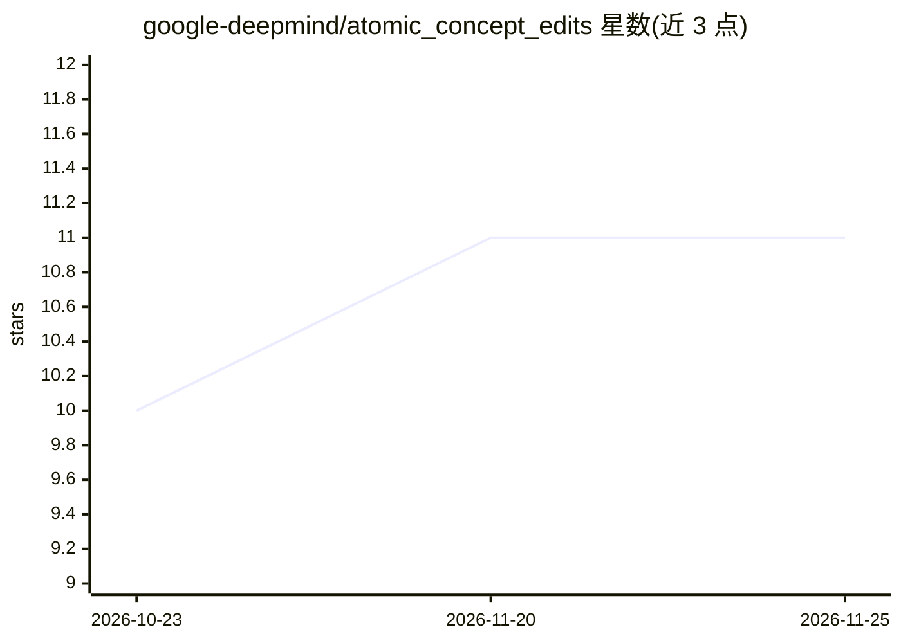

# google-deepmind/atomic_concept_edits

⭐ 11 · Python · Apache-2.0 · 推送 2026-08-19 · [GitHub](https://github.com/google-deepmind/atomic_concept_edits) · 组织维护

**面向研究者的提示词原子级概念编辑探索与优化框架**

ACE 将提示词分解为单个概念并生成增删改的原子突变，通过树搜索（ACE Exploration）迭代评估其对目标模型行为的影响；配套 Constitution Optimizer 用替代分类器学习一组引导突变过程的策略。目标用户提供配置文件、demo notebook 与运行脚本，以 Python 包形式安装（pyproject.toml，可编辑模式，可选依赖含 OpenAI/Anthropic/HF/TensorFlow Datasets）。附论文引用条目，版权归 Google LLC。

## 筛选速览

| 维度 | 判定 | 备注 |
|---|---|---|
| AI 角色 | `ai-ecosystem` | LLM/agent 周边工具 |
| 许可风险 | `permissive` | Apache-2.0 |
| 部署形态 | `library` | 以包/库形式分发 |
| 模型依赖 | — | README 未给出锁定关系 |
| 硬件要求 | — | 无带数字的原话,不猜 |
| 安装摩擦 | `low` | 无编译、无系统依赖或容器化 |
| 成熟度 | — | 结构信号不足 |

## 能力要点

- 树搜索算法迭代突变提示词并按评分器扩展最有前景分支
- Constitution Optimizer 学习策略集合以预测满足目标的编辑
- 支持 OpenAI、Anthropic、Hugging Face Datasets、TensorFlow Datasets 可选依赖
- 提供 word_count 示例 demo notebook 与配置文件运行方式

## 适用场景

- 系统性探索小幅度提示词改动对模型行为的影响
- 为特定目标学习一套指导提示词编辑的策略（constitution）
- 复现论文中的提示词优化实验

## 场景标签

`提示工程` · 领域:Agent 开发

## 证据(README 行号)

> L3: ACE is a framework for systematic prompt exploration and optimization through
> L13: - **Constitution Optimizer**: An optimization loop that learns a
> L20: ## Installation

## 星数曲线

2026-10-23 10 → 2026-11-25 11（+1）

---
*卡片 v1 · prompt 1.4 · 生成 2026-11-19 · 置信度 high · 依据 README sha `a18288fa5dd9` · [字段定义](../../DATASET.md)*
