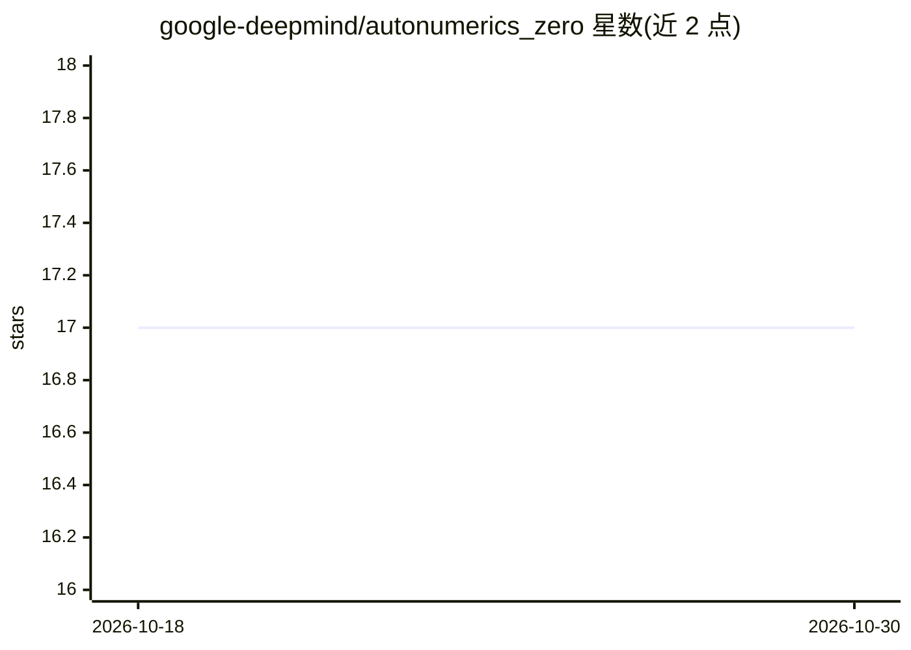

# google-deepmind/autonumerics_zero

⭐ 17 · Python · Apache-2.0 · 推送 2026-06-23 · [GitHub](https://github.com/google-deepmind/autonumerics_zero) · 组织维护

**自动发现超越函数高效计算程序的搜索方法实现**

DeepMind 发布的 AutoNumerics-Zero 代码：一种从零开始、不依赖数值方法先验知识，通过演化搜索自动生成高效计算超越函数（如数学库函数）的程序的方法。仓库以 Bazel 工程形式提供，包含一个示例实验配置，可运行演化 worker 复现搜索过程。编译需要 Clang（CC=clang++）。配套 arXiv 论文 2312.08472 可引用，代码版权归 DeepMind 所有。

## 筛选速览

| 维度 | 判定 | 备注 |
|---|---|---|
| AI 角色 | `ai-native` | 本体是模型或模型工具 |
| 许可风险 | `permissive` | Apache-2.0 |
| 部署形态 | `None` |  |
| 模型依赖 | — | README 未给出锁定关系 |
| 硬件要求 | — | 无带数字的原话,不猜 |
| 安装摩擦 | `low` | 无编译、无系统依赖或容器化 |
| 成熟度 | — | 结构信号不足 |

## 能力要点

- 从零演化搜索生成超越函数计算程序，无需数值方法先验知识
- 包含示例实验配置，可通过 bazel run 运行演化 worker
- 编译依赖 Clang（CC=clang++）

## 适用场景

- 复现论文中的自动数值函数发现实验
- 研究程序演化搜索在数学函数逼近中的应用

## 场景标签

`代码生成` `科研工具` · 领域:编码与开发

## 证据(README 行号)

> L3: AutoNumerics-Zero, a method to evolve programs that compute transcendental
> L4: functions efficiently—searching from scratch and without knowledge of numerics.

## 星数曲线

2026-10-18 17 → 2026-10-30 17（+0）

---
*卡片 v1 · prompt 1.4 · 生成 2026-10-29 · 置信度 high · 依据 README sha `feb2d11e86c5` · [字段定义](../../DATASET.md)*
