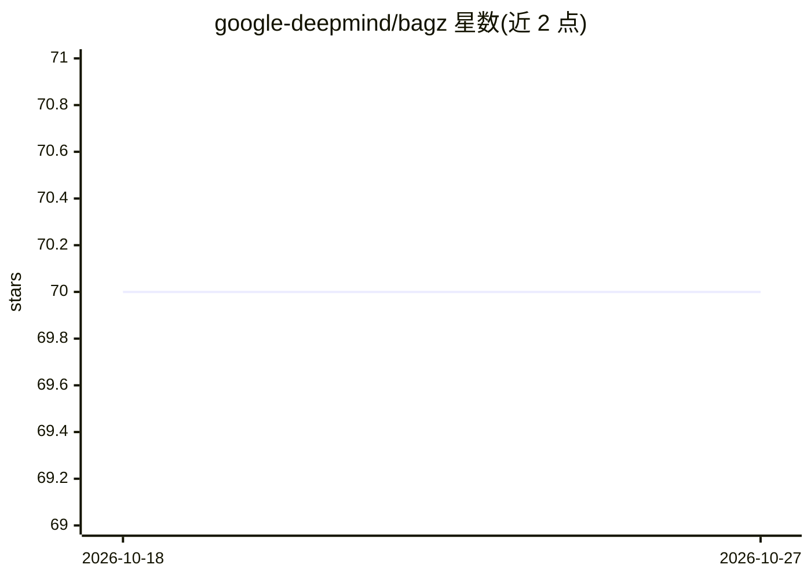

# google-deepmind/bagz

⭐ 70 · C++ · Apache-2.0 · 推送 2026-09-10 · [GitHub](https://github.com/google-deepmind/bagz) · 组织维护

**面向开发者：存储序列化记录序列的 Bagz 文件格式与 Python 读写库**

Bagz 是一种存储字节记录（通常为序列化 protocol buffer）序列的文件格式，配套提供 Python 读写 API。支持逐记录压缩（Zstandard）、基于零起始索引的快速查找、分片（sharding）的两种全局索引布局（Concatenated/Interleaved）、尾置或分离的 limits 存储，以及 Posix 与 GCS 文件系统访问。还提供 Apache Beam 连接器用于在 Beam 流水线中读写 Bagz 文件。从源码构建需 cmake、curl 与 OpenSSL 开发库；Linux/macOS 可从 PyPI 安装。

## 筛选速览

| 维度 | 判定 | 备注 |
|---|---|---|
| AI 角色 | `ai-ecosystem` | LLM/agent 周边工具 |
| 许可风险 | `permissive` | Apache-2.0 |
| 部署形态 | `library` | 以包/库形式分发 |
| 模型依赖 | — | README 未给出锁定关系 |
| 硬件要求 | — | 无带数字的原话,不猜 |
| 安装摩擦 | `low` | 无编译、无系统依赖或容器化 |
| 成熟度 | — | 结构信号不足 |

## 能力要点

- 逐记录 Zstandard 压缩与索引式快速查找
- 单文件与多分片文件集读取，两种 global-index 布局
- Apache Beam Source/Sink 连接器
- 支持 Posix 文件系统与 GCS（gs: 前缀访问）

## 适用场景

- 以紧凑格式存储序列化的训练/数据管道记录
- 在 Beam 流水线中读写 Bagz 格式数据
- 对分片数据集做全局索引随机访问

## 场景标签

`MLOps` · 领域:训练与推理

## 证据(README 行号)

> L5: *Bagz* is a format for storing a sequence of byte-array records, typically
> L136: Bagz also provides Apache Beam connectors for reading and writing Bagz files in

## 星数曲线

2026-10-18 70 → 2026-10-27 70（+0）

---
*卡片 v1 · prompt 1.4 · 生成 2026-10-24 · 置信度 mid · 依据 README sha `f9c7287d5e61` · [字段定义](../../DATASET.md)*
