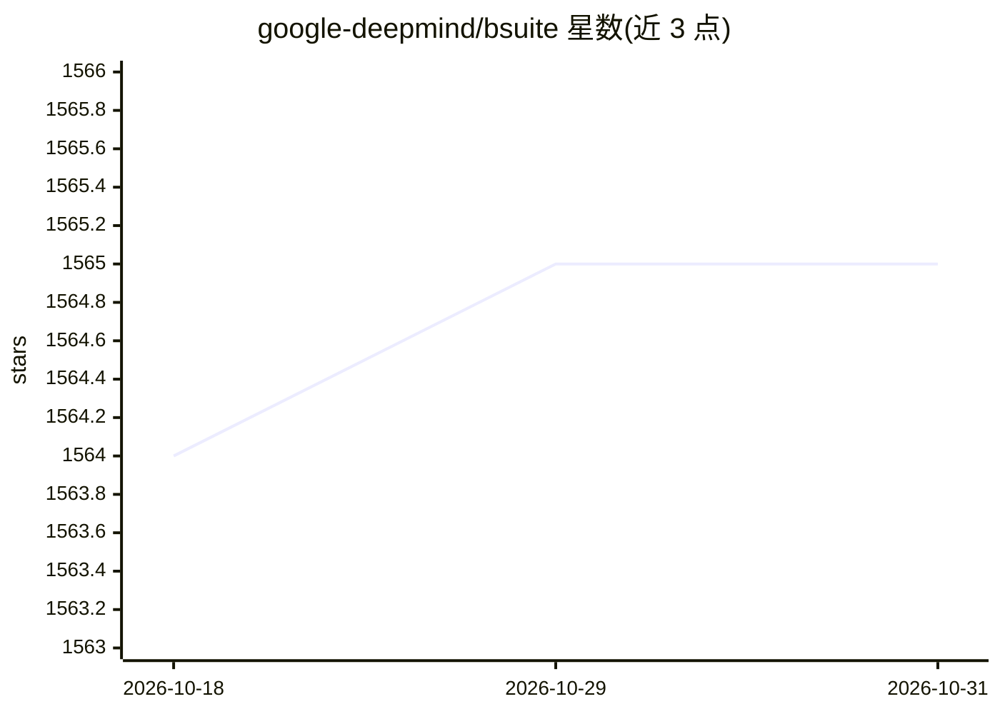

# google-deepmind/bsuite

⭐ 1,565 · Python · Apache-2.0 · 推送 2026-10-05 · [GitHub](https://github.com/google-deepmind/bsuite) · 组织维护

**RL 智能体核心能力评测基准实验套件**

DeepMind 维护的强化学习评测基准库：提供一组经过设计的实验环境（每个环境带可配置难度/种子与 SETTINGS 参数序列），通过 load_and_record* 在环境内部自动记录实验数据，输出标准格式 CSV 供预置 Jupyter notebook 分析并生成雷达图评分。环境实现 dm_env 接口，可经 GymFromDMEnv 包装为 OpenAI Gym 格式；附多个基线智能体实现与并行跑全套实验的 run 脚本，另支持在 Google Cloud 上运行并生成会议格式的 1 页能力附录。在 Python 3.6/3.7 上测试，pip 安装。

## 筛选速览

| 维度 | 判定 | 备注 |
|---|---|---|
| AI 角色 | `ai-ecosystem` | LLM/agent 周边工具 |
| 许可风险 | `permissive` | Apache-2.0 |
| 部署形态 | `library` | 以包/库形式分发 |
| 模型依赖 | — | README 未给出锁定关系 |
| 硬件要求 | — | 无带数字的原话,不猜 |
| 安装摩擦 | `low` | 无编译、无系统依赖或容器化 |
| 成熟度 | — | 结构信号不足 |

## 能力要点

- 按 bsuite_id 加载实验环境，load_and_record_to_csv 自动记录数据
- 预置 Jupyter notebook 分析并生成各实验评分与雷达图
- GymFromDMEnv 包装器支持 OpenAI Gym 接口
- 可自动生成兼容主流 ML 会议格式的 1 页算法能力附录

## 适用场景

- 评测自研 RL 算法在共享基准上的核心能力表现
- 论文中生成标准化的 bsuite 评分附录
- 在本地多进程或 Google Cloud 上跑全套实验

## 场景标签

`模型评测` · 领域:评测与运维

## 证据(README 行号)

> L11: `bsuite` is a collection of carefully-designed experiments that investigate core
> L19: This library automates evaluation and analysis of any agent on these benchmarks.

## 星数曲线

2026-10-18 1,564 → 2026-10-31 1,565（+1）

---
*卡片 v1 · prompt 1.4 · 生成 2026-10-21 · 置信度 high · 依据 README sha `6af93dba2dca` · [字段定义](../../DATASET.md)*
