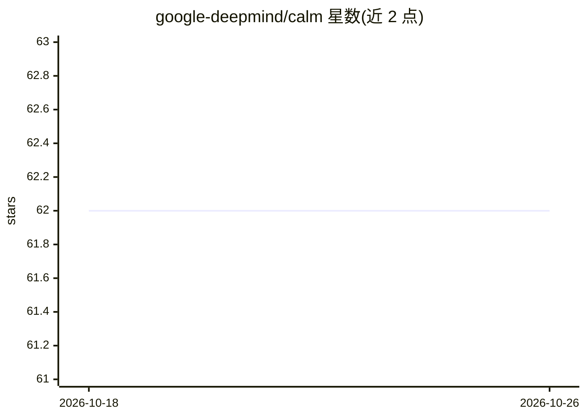

# google-deepmind/calm

⭐ 62 · Python · Apache-2.0 · 推送 2026-07-02 · [GitHub](https://github.com/google-deepmind/calm) · 组织维护

**通过交叉注意力组合两个 LLM 的研究框架代码**

Google DeepMind 发布的 CALM（Composition to Augment Language Models）框架实现，对应论文《LLM Augmented LLMs: Expanding Capabilities through Composition》。核心机制是在两个语言模型之间引入交叉注意力，组合二者的表示以获得新能力；目前支持组合任意两个基于 Gemma 架构的模型。提供初始化组合模型、保存/加载、用 Hugging Face Trainer 微调、多 GPU 训练（accelerate FSDP）与生成等流程，需 Python 3.11+ 与 Hugging Face 访问令牌。

## 筛选速览

| 维度 | 判定 | 备注 |
|---|---|---|
| AI 角色 | `ai-ecosystem` | LLM/agent 周边工具 |
| 许可风险 | `permissive` | Apache-2.0 |
| 部署形态 | `library` | 以包/库形式分发 |
| 模型依赖 | — | README 未给出锁定关系 |
| 硬件要求 | — | 无带数字的原话,不猜 |
| 安装摩擦 | `low` | 无编译、无系统依赖或容器化 |
| 成熟度 | — | 结构信号不足 |

## 能力要点

- 通过交叉注意力组合 anchor 与 augmenting 两个模型
- 支持任意两个 Gemma 架构模型的组合
- 提供基于 Hugging Face Trainer 与 Accelerate FSDP 的多 GPU 训练示例
- 组合模型可保存/加载并按 transformers 模型方式生成

## 适用场景

- 复现论文中的 LLM 组合实验
- 研究两个 Gemma 模型的表示组合与能力扩展
- 用 Wikitext 等数据微调组合模型

## 场景标签

`微调` · 领域:训练与推理

## 证据(README 行号)

> L3: This repository provides the code for implementing the CALM (Composition to Augment Language Models) framework descr
> L67: An example multi-gpu training pipeline is given in `train.py` where we train a composed gemma-2b and gemma-7b using

## 星数曲线

2026-10-18 62 → 2026-10-26 62（+0）

---
*卡片 v1 · prompt 1.4 · 生成 2026-10-24 · 置信度 mid · 依据 README sha `f1a5349f749a` · [字段定义](../../DATASET.md)*
