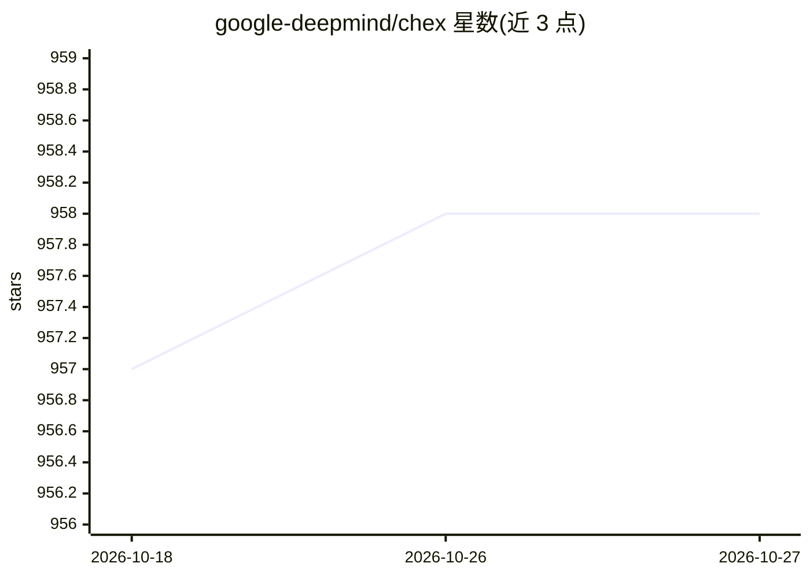

# google-deepmind/chex

⭐ 958 · Python · Apache-2.0 · 推送 2026-10-07 · [GitHub](https://github.com/google-deepmind/chex) · [官网](https://chex.readthedocs.io) · 组织维护

**JAX 代码的测试与调试工具库：断言、变体测试、调试变换**

DeepMind 维护的 Python 工具库，面向编写 JAX 代码的开发者。提供 JAX 友好的 dataclass（注册为 PyTree 节点）、针对张量 shape/rank/dtype 的静态与运行时断言（含 chexify 使 jitted 代码可做值断言）、跨 jit/pmap/device 等变换重复执行单元测试的 variants 机制、以 vmap 替换 pmap 等调试用的 fake 工具、单 CPU 多线程模拟多设备环境、限制后端编译的 restrict_backends 以及命名维度尺寸工具。通过 pip 从 PyPI 或 GitHub 安装。

## 筛选速览

| 维度 | 判定 | 备注 |
|---|---|---|
| AI 角色 | `ai-ecosystem` | LLM/agent 周边工具 |
| 许可风险 | `permissive` | Apache-2.0 |
| 部署形态 | `library` | 以包/库形式分发 |
| 模型依赖 | — | README 未给出锁定关系 |
| 硬件要求 | — | 无带数字的原话,不猜 |
| 安装摩擦 | `low` | 无编译、无系统依赖或容器化 |
| 成熟度 | — | 结构信号不足 |

## 能力要点

- 张量 shape/rank/dtype 断言，分 static 与 value 两类，chexify 支持 jitted 代码中的值断言
- variants 装饰器使同一测试覆盖 with/without jit、pmap、device 等多种代码变换
- fake_pmap/fake jit 等上下文管理器将 pmap 替换为 vmap 以便单设备调试
- chex_n_cpu_devices 用单 CPU 多线程模拟多设备（TPU/多 GPU）测试环境

## 适用场景

- 为 JAX 项目编写覆盖 jit/pmap/device 等变换路径的单元测试
- 在训练循环中断言参数未被 NaN 污染、张量形状符合预期
- 无多卡/TPU 环境下测试并行（pmap）代码
- 调试时全局关闭 jit 或把 pmap 换成 vmap 以便检查中间值

## 场景标签

 · 领域:机器学习工程工具

## 证据(README 行号)

> L7: Chex is a library of utilities for helping to write reliable JAX code.
> L195: JAX relies extensively on code transformation and compilation, meaning that it

## 星数曲线

2026-10-18 957 → 2026-10-27 958（+1）

---
*卡片 v1 · prompt 1.4 · 生成 2026-10-21 · 置信度 high · 依据 README sha `6fcfa63c74ed` · [字段定义](../../DATASET.md)*
