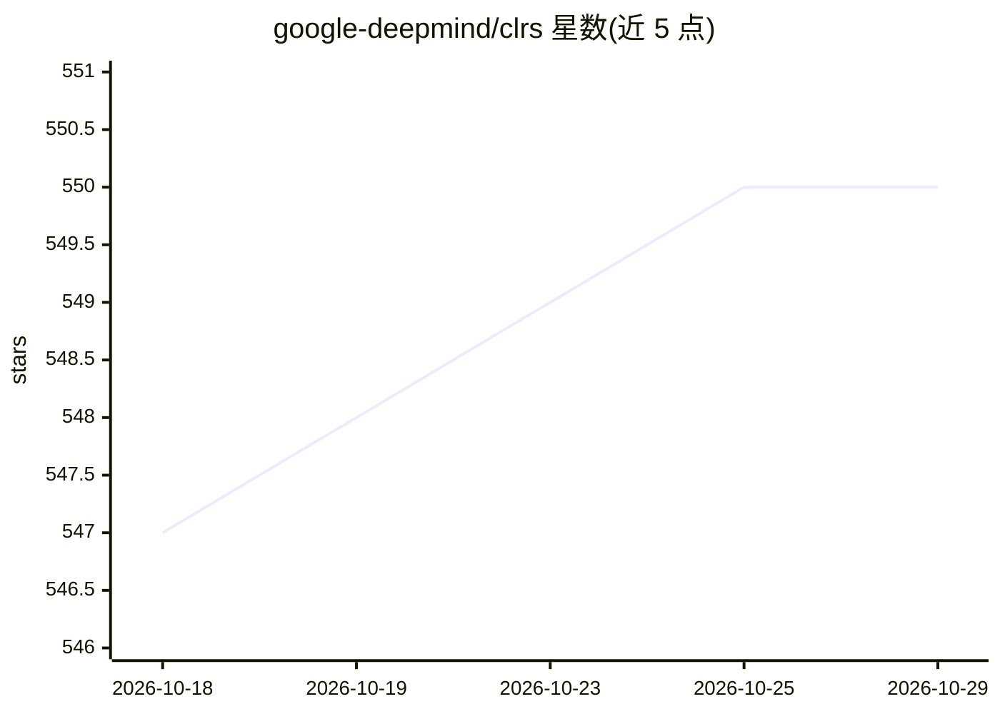

# google-deepmind/clrs

⭐ 550 · Jupyter Notebook · Apache-2.0 · 推送 2026-10-07 · [GitHub](https://github.com/google-deepmind/clrs) · 组织维护

**面向算法推理的基准套件：30 个经典算法数据与评测**

DeepMind 维护的 CLRS 算法推理基准：将《算法导论》第三版中选取的 30 个经典算法（排序、搜索、图算法、字符串匹配、几何等）以贴近原书伪代码的方式实现，自动生成输入/输出对，并提供暴露算法内部状态的轨迹 hints 与 train/eval/test 划分（测试集用更大问题规模考察分布外泛化）。附带 JAX 实现的 6 种 GNN 基线处理器、示例训练脚本，以及面向语言模型算法推理评测的 CLRS-Text 文本变体。以 Python 包（dm-clrs）经 pip 安装，供神经网络算法推理方向的研究者使用。

## 筛选速览

| 维度 | 判定 | 备注 |
|---|---|---|
| AI 角色 | `ai-knowledge` | 知识聚合/清单类 |
| 许可风险 | `permissive` | Apache-2.0 |
| 部署形态 | `library` | 以包/库形式分发 |
| 模型依赖 | — | README 未给出锁定关系 |
| 硬件要求 | — | 无带数字的原话,不猜 |
| 安装摩擦 | `low` | 无编译、无系统依赖或容器化 |
| 成熟度 | — | 结构信号不足 |

## 能力要点

- 30 个经典算法的自动数据生成与 train/eval/test 轨迹划分
- 提供暴露算法中间状态的 hints 轨迹
- 6 种 JAX 实现的 GNN 基线处理器（Deep Sets/GAT/MPNN/PGN 等）
- CLRS-Text 文本变体，用于评测语言模型的算法推理能力

## 适用场景

- 评测神经网络对经典算法的分布外泛化能力
- 在统一基准上对比不同 GNN 处理器架构
- 为语言模型算法推理研究生成文本化任务数据

## 场景标签

`模型评测` · 领域:评测与运维

## 证据(README 行号)

> L5: CLRS Algorithmic Reasoning Benchmark (CLRS) consolidates and extends previous
> L6: work toward evaluation algorithmic reasoning by providing a suite of
> L64: For each algorithm, we provide a canonical set of *train*, *eval* and *test*

## 星数曲线

2026-10-18 547 → 2026-10-29 550（+3）

---
*卡片 v1 · prompt 1.4 · 生成 2026-10-21 · 置信度 high · 依据 README sha `c01d1cd8b8a3` · [字段定义](../../DATASET.md)*
