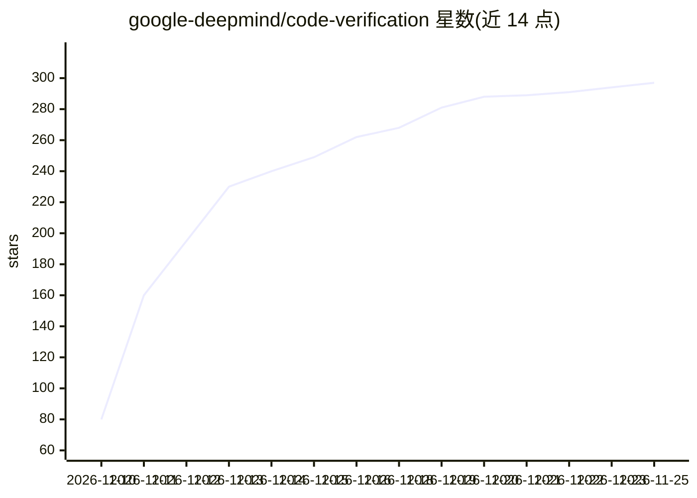

# google-deepmind/code-verification

⭐ 297 · Lean · NOASSERTION · 推送 2026-11-20 · [GitHub](https://github.com/google-deepmind/code-verification) · [官网](https://google-deepmind.github.io/code-verification/) · 组织维护

**Signal 协议编译后机器码安全性的 Lean 形式化证明仓库**

Google DeepMind 发布的形式化验证项目：对 libsignal（Signal 协议的官方 Rust 实现）编译后的 AArch64 机器码给出两份 AI 生成的安全证明，分别基于符号模型与计算模型。仓库按 Computational/Symbolic/LibsignalBinary 组织，提供 lake 构建与内核校验流程，并通过 leanprover/comparator 从零重放证明、限定标准公理集，另附 trusted_closure 脚本审计公理与可信基础；comparator 校验仅支持 Linux。附带论文与 PAPER_MAP 章节到代码的映射。

## 筛选速览

| 维度 | 判定 | 备注 |
|---|---|---|
| AI 角色 | `ai-knowledge` | 知识聚合/清单类 |
| 许可风险 | `none` | NOASSERTION |
| 部署形态 | `None` |  |
| 模型依赖 | — | README 未给出锁定关系 |
| 硬件要求 | — | 无带数字的原话,不猜 |
| 安装摩擦 | `low` | 无编译、无系统依赖或容器化 |
| 成熟度 | — | 结构信号不足 |

## 能力要点

- 对编译后 AArch64 机器码的符号模型与计算模型双路安全证明
- comparator 从 lean4export 输出在全新 Lean 内核重放证明并限定公理集
- trusted-closure 脚本计算定理传递闭包并列出各定理内核公理
- 文档记录偏差目录（DEVIATIONS）与可信基础（TRUSTED_BASE）

## 适用场景

- 审计 libsignal 编译产物的形式化安全证明与可信基础
- 研究密码协议机器码级别的符号/计算安全建模方法
- 查阅论文定理到 Lean 形式化代码的对应关系

## 场景标签

`科研工具` · 领域:学习与行业

## 证据(README 行号)

> L7: We present two AI-generated proofs of security for compiled AArch64 machine code of
> L46: ├── Computational/     # Computational (game-based) security specs, proofs, and headline theorems
> L47: ├── Symbolic/          # Symbolic (Dolev–Yao) model, binary refinement, proofs, and theorems

## 星数曲线

2026-11-10 80 → 2026-11-25 297（+217）

---
*卡片 v1 · prompt 1.4 · 生成 2026-11-25 · 置信度 high · 依据 README sha `9d6f42f69ece` · [字段定义](../../DATASET.md)*
