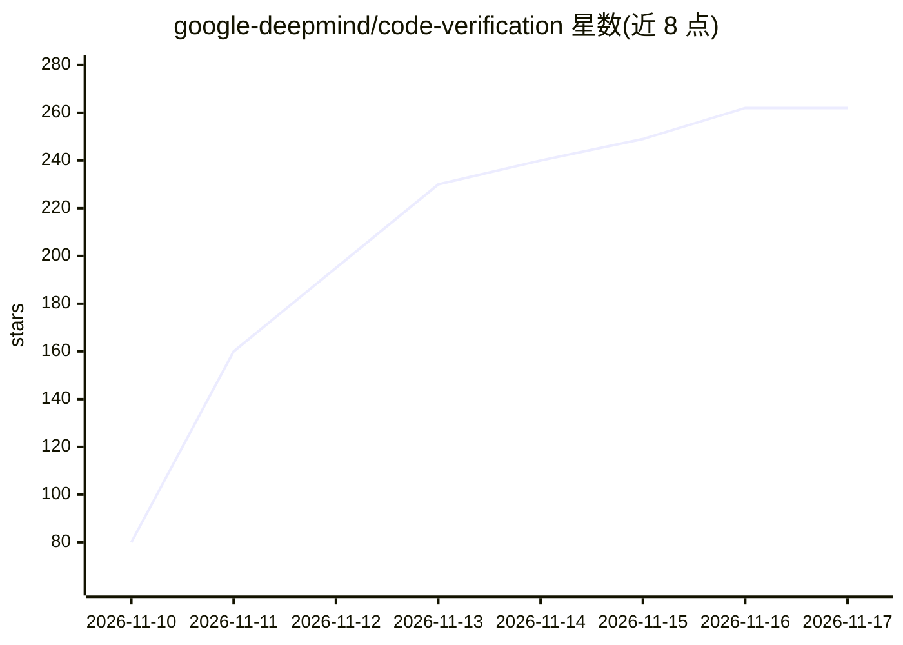

# google-deepmind/code-verification

⭐ 262 · Lean · NOASSERTION · 推送 2026-11-11 · [GitHub](https://github.com/google-deepmind/code-verification) · [官网](https://google-deepmind.github.io/code-verification/) · 组织维护

**在 Lean 中形式化验证 Signal 机器码安全性的证明集合**

Google DeepMind 发布的形式化验证项目：针对 libsignal（Signal 协议官方 Rust 实现）编译后的 AArch64 机器码，在 CLI harness（挂钩密码原语）下给出两个 AI 生成的安全证明，分别基于符号模型（Dolev–Yao）与计算模型（game-based）。仓库包含证明代码、二进制规约与定理；可用 leanprover/comparator 在独立 Lean 内核中重放验证标题定理。构建依赖 Lean 4（elan 固定版本）、Rust 交叉编译工具链、protoc、LLVM lld 与 Zig；comparator 检查仅支持 Linux。

## 筛选速览

| 维度 | 判定 | 备注 |
|---|---|---|
| AI 角色 | `ai-knowledge` | 知识聚合/清单类 |
| 许可风险 | `none` | NOASSERTION |
| 部署形态 | `None` |  |
| 模型依赖 | — | README 未给出锁定关系 |
| 硬件要求 | — | 无带数字的原话,不猜 |
| 安装摩擦 | `low` | 无编译、无系统依赖或容器化 |
| 成熟度 | — | 结构信号不足 |

## 能力要点

- libsignal 编译后 AArch64 机器码的安全形式化证明
- 符号模型与计算模型两条独立论证
- comparator 在全新 Lean 内核重放定理并限制仅用标准公理
- 提供 PAPER_MAP.md 将论文章节映射到 Lean 代码

## 适用场景

- 审阅或复现 Signal 机器码安全性的形式化证明
- 按论文定位对应 Lean 定理与代码
- 作为密码协议机器码级形式化验证的研究参考

## 场景标签

 · 领域:形式化验证/信息安全

## 证据(README 行号)

> L7: We present two AI-generated proofs of security for compiled AArch64 machine code of
> L8: `libsignal` (the official Rust implementation of the Signal protocol) in a CLI harness
> L9: (with hooked cryptographic primitives). These provide independent arguments for

## 星数曲线

2026-11-10 80 → 2026-11-17 262（+182）

---
*卡片 v1 · prompt 1.4 · 生成 2026-11-17 · 置信度 mid · 依据 README sha `4ccaec322381` · [字段定义](../../DATASET.md)*
