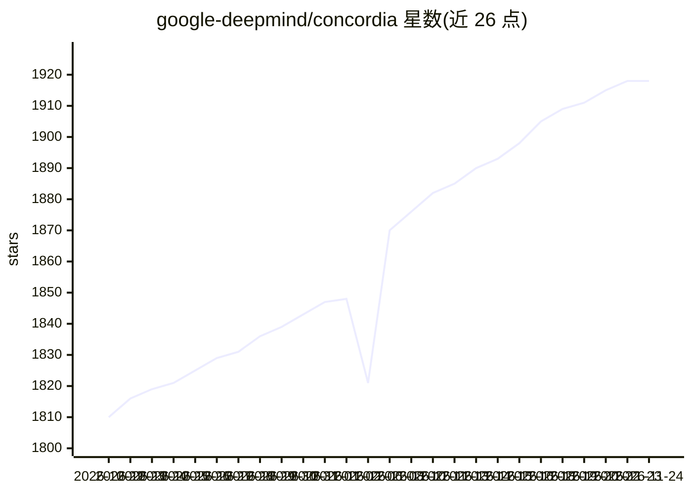

# google-deepmind/concordia

⭐ 1,922 · Python · Apache-2.0 · 推送 2026-11-19 · [GitHub](https://github.com/google-deepmind/concordia) · 组织维护

**生成式社会模拟库：构建基于 LLM 的多智能体社会仿真**

Concordia 是一个用于构建与运行生成式智能体模拟的 Python 库，采用桌面角色扮演游戏式交互模式：Game Master 实体模拟环境，玩家实体以自然语言描述行动并由 GM 判定结果。模拟由实体、组件、Prefab 模板与引擎组织，支持回合制、同步与异步执行。需访问一个支持文本采样的 LLM API，并需提供文本嵌入器用于联想记忆，另有 GUI 与 CLI 编辑器。面向社会科学、AI 安全、认知神经科学、经济学等研究场景。

## 筛选速览

| 维度 | 判定 | 备注 |
|---|---|---|
| AI 角色 | `ai-ecosystem` | LLM/agent 周边工具 |
| 许可风险 | `permissive` | Apache-2.0 |
| 部署形态 | `library` | 以包/库形式分发 |
| 模型依赖 | — | README 未给出锁定关系 |
| 硬件要求 | — | 无带数字的原话,不猜 |
| 安装摩擦 | `low` | 无编译、无系统依赖或容器化 |
| 成熟度 | — | 结构信号不足 |

## 能力要点

- Game Master/玩家实体分工的桌游式交互模拟模式
- 实体-组件架构与预置 Prefab 模板可参数化实例化
- 支持任意可采样文本的 LLM API（bring your own LLM）
- 提供 GUI/CLI 实体组件编辑器与教程示例

## 适用场景

- 开展社会科学中的生成式智能体仿真实验
- 为个性化场景生成合成数据
- 通过模拟使用评估真实服务的表现
- AI 安全与伦理相关研究中的智能体行为模拟

## 场景标签

`多智能体` · 领域:Agent 开发

## 证据(README 行号)

> L15: Concordia is a library for constructing and running generative agent-based
> L59: * **`concordia/language_model`**: LLM
> L140: Concordia requires access to an LLM API. Any LLM API that supports sampling

## 星数曲线

2026-10-22 1,810 → 2026-11-24 1,918（+108）

---
*卡片 v1 · prompt 1.4 · 生成 2026-11-23 · 置信度 high · 依据 README sha `c05f9cae2d90` · [字段定义](../../DATASET.md)*
