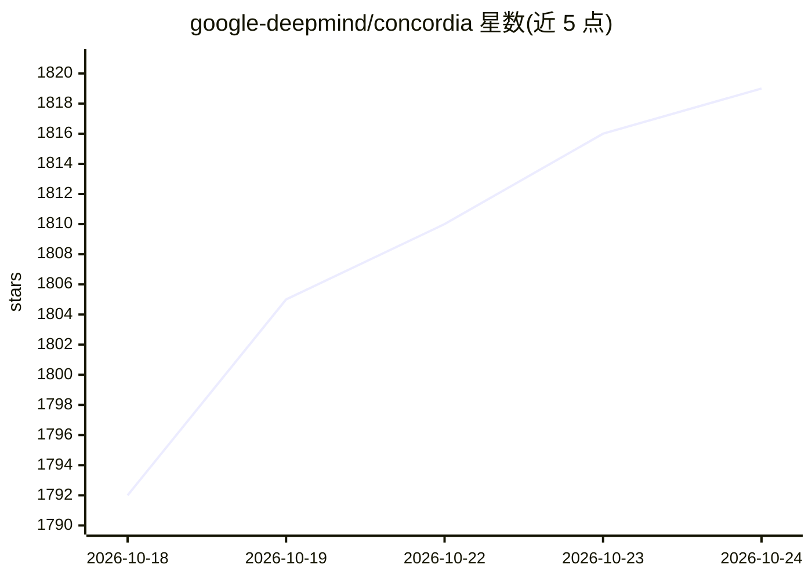

# google-deepmind/concordia

⭐ 1,821 · Python · Apache-2.0 · 推送 2026-10-20 · [GitHub](https://github.com/google-deepmind/concordia) · 组织维护

**生成式社会模拟库：用 LLM 驱动 agent 在环境中交互**

Google DeepMind 维护的 Python 库，用于构建与运行生成式 agent 社会模拟：实体以自然语言描述意图，Game Master 实体翻译为环境结果并检查物理合理性。实体由组件（记忆、指令、行动选择）构成，提供预置 prefab 与 GUI/CLI 编辑界面。支持社会科学、AI 安全、经济学、合成数据生成等应用。运行需接入标准 LLM API 与文本嵌入器，任何支持采样的 LLM API 均可配合。

## 筛选速览

| 维度 | 判定 | 备注 |
|---|---|---|
| AI 角色 | `ai-ecosystem` | LLM/agent 周边工具 |
| 许可风险 | `permissive` | Apache-2.0 |
| 部署形态 | `library` | 以包/库形式分发 |
| 模型依赖 | — | README 未给出锁定关系 |
| 硬件要求 | — | 无带数字的原话,不猜 |
| 安装摩擦 | `low` | 无编译、无系统依赖或容器化 |
| 成熟度 | — | 结构信号不足 |

## 能力要点

- Game Master 模式模拟环境并裁决实体行动结果
- 实体-组件架构与预置 prefab 模板
- 模块包含记忆系统、LLM 集成封装与 prompt 管理工具
- 提供 GUI/CLI 编辑器、教程与 Colab 示例

## 适用场景

- 搭建社会科学或经济学领域的生成式 agent 模拟
- 生成合成数据用于个性化或服务评估
- 研究 AI 安全与伦理场景下的 agent 行为

## 场景标签

`多智能体` `Agent 框架` · 领域:Agent 开发

## 证据(README 行号)

> L15: Concordia is a library for constructing and running generative agent-based
> L59: * **`concordia/language_model`**: LLM

## 星数曲线

2026-10-18 1,792 → 2026-10-24 1,819（+27）

---
*卡片 v1 · prompt 1.4 · 生成 2026-10-21 · 置信度 high · 依据 README sha `6509e707b2e0` · [字段定义](../../DATASET.md)*
