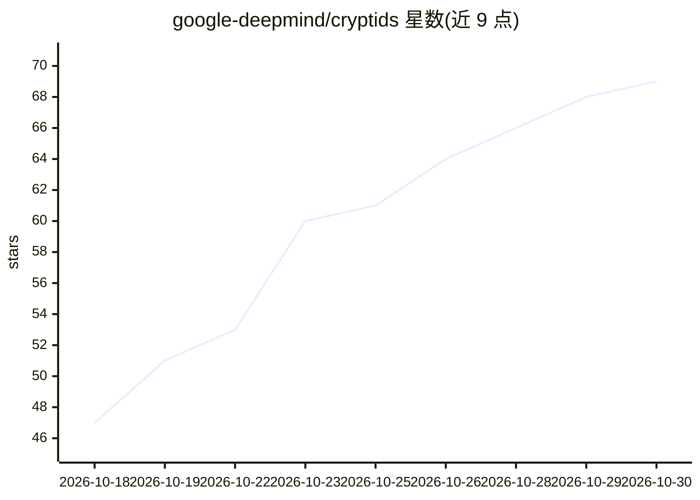

# google-deepmind/cryptids

⭐ 69 · Lean · Apache-2.0 · 推送 2026-10-27 · [GitHub](https://github.com/google-deepmind/cryptids) · [官网](https://google-deepmind.github.io/cryptids/) · 组织维护

**Lean 4 形式化验证库：图灵机与 Busy Beaver 停机证明**

包含两个 Lean 4 形式化库：Cryptids 部分为哥德巴赫猜想、ZF 一致性、黎曼猜想给出经过内核检查的状态归约与端到端停机等价证明（Halts M ↔ 数学命题）；BusyBeaver 部分为 BB(6) 的 53 台与 BB(3,3) 的 6 台 holdout 图灵机提供行为证明，其中部分机器经由自主 agentic 流程发现。全部证明无 sorry、仅依赖标准 Lean 公理，并区分构造性与经典证明经 CI 审计。面向形式化方法与计算理论研究者，需 Lean 4 (v4.35.0-rc4) 工具链与 Mathlib 缓存构建。

## 筛选速览

| 维度 | 判定 | 备注 |
|---|---|---|
| AI 角色 | `ai-enhanced` | 去掉 AI 部分产品仍成立 |
| 许可风险 | `permissive` | Apache-2.0 |
| 部署形态 | `None` |  |
| 模型依赖 | — | README 未给出锁定关系 |
| 硬件要求 | — | 无带数字的原话,不猜 |
| 安装摩擦 | `low` | 无编译、无系统依赖或容器化 |
| 成熟度 | — | 结构信号不足 |

## 能力要点

- 哥德巴赫/ZF 一致性/黎曼猜想的端到端 Lean 4 停机等价证明
- BB(6) 53 台、BB(3,3) 6 台 holdout 图灵机的内核验证行为证明
- 全部证明无 sorry，区分构造性与经典公理并经 comparator CI 审计
- 提供独立 Python 3 验证脚本与机器转移表 artifacts

## 适用场景

- 核对猜想检查图灵机与数学命题等价性的形式化证明
- 复现并审计 Busy Beaver holdout 机器的停机/不停机证明
- 作为 (Q,2) 图灵机形式化与状态归约的参考实现

## 场景标签

 · 领域:形式化验证/计算理论

## 证据(README 行号)

> L3: This repository contains two Lean 4 (`v4.35.0-rc4`) formalization libraries for small Turing machines whose halting 
> L6: 2. **Busy Beaver Holdouts (`BusyBeaver/`)** — Kernel-verified behavioral proofs (`IsHalt`, `IsNotHalt`, `HasCollatzR

## 星数曲线

2026-10-18 47 → 2026-10-30 69（+22）

---
*卡片 v1 · prompt 1.4 · 生成 2026-10-24 · 置信度 mid · 依据 README sha `2cd21efaa586` · [字段定义](../../DATASET.md)*
