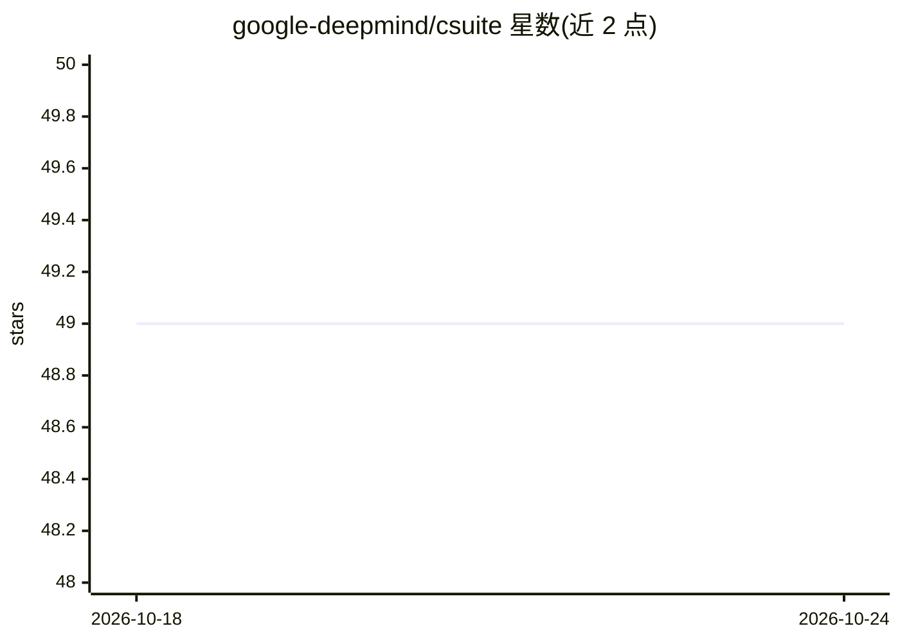

# google-deepmind/csuite

⭐ 49 · Python · Apache-2.0 · 推送 2026-07-22 · [GitHub](https://github.com/google-deepmind/csuite) · 组织维护

**持续强化学习研究的合成环境集合**

DeepMind 维护的开源 Python 库，提供一组经过挑选的合成环境，用于持续（continuing）设定下的强化学习研究：智能体与环境交互没有自然回合边界。环境遵循 csuite/environment/base.py 定义的 Python 接口，可用 csuite.load 加载；对使用 dm_env 接口的代码库提供 DMEnvFromCSuite 包装类。通过 git clone 后 pip 从源码安装，尚未发布到 PyPI。面向强化学习方向的研究者。

## 筛选速览

| 维度 | 判定 | 备注 |
|---|---|---|
| AI 角色 | `ai-ecosystem` | LLM/agent 周边工具 |
| 许可风险 | `permissive` | Apache-2.0 |
| 部署形态 | `library` | 以包/库形式分发 |
| 模型依赖 | — | README 未给出锁定关系 |
| 硬件要求 | — | 无带数字的原话,不猜 |
| 安装摩擦 | `low` | 无编译、无系统依赖或容器化 |
| 成熟度 | — | 结构信号不足 |

## 能力要点

- 提供持续设定（无回合边界）的合成环境集合
- 环境遵循统一的 Python 接口（base.py）
- 提供 dm_env 接口包装类 DMEnvFromCSuite

## 适用场景

- 在无回合边界的持续设定下评估强化学习算法
- 在现有 dm_env 代码库中接入 CSuite 环境
- 强化学习方法的对照实验研究

## 场景标签

`强化学习` · 领域:训练与推理

## 证据(README 行号)

> L3: CSuite is a collection of carefully-curated synthetic environments for
> L20: CSuite environments adhere to the Python interface defined in `csuite/environment/base.py`.

## 星数曲线

2026-10-18 49 → 2026-10-24 49（+0）

---
*卡片 v1 · prompt 1.4 · 生成 2026-10-24 · 置信度 mid · 依据 README sha `31a430f561e0` · [字段定义](../../DATASET.md)*
