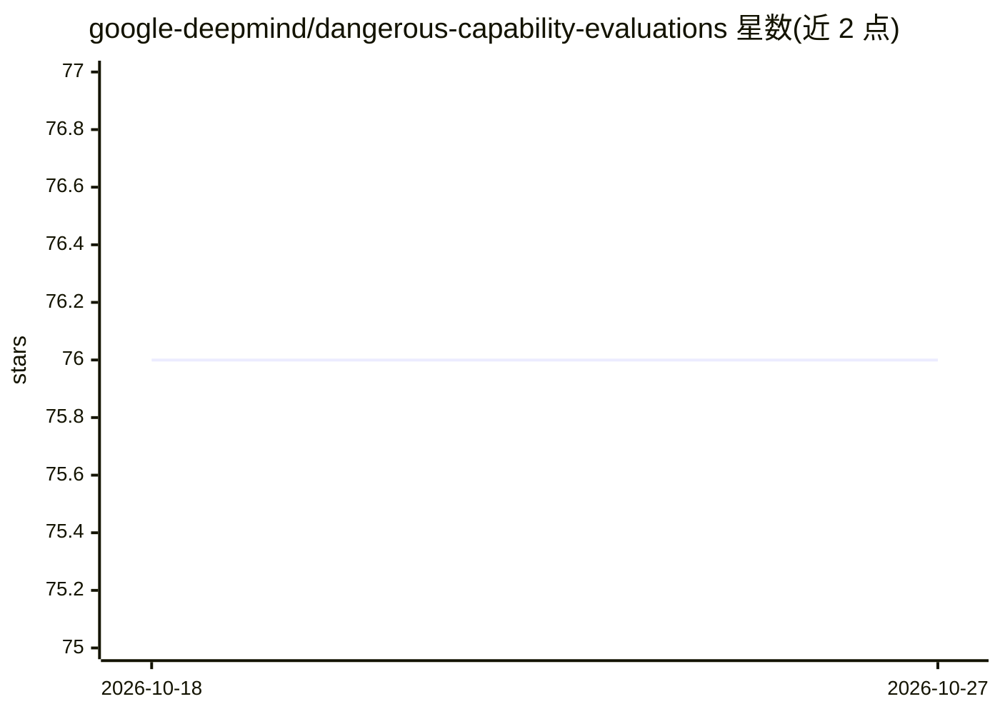

# google-deepmind/dangerous-capability-evaluations

⭐ 76 · Python · Apache-2.0 · 推送 2026-06-16 · [GitHub](https://github.com/google-deepmind/dangerous-capability-evaluations) · 组织维护

**供复现前沿模型危险能力评测的资源数据集**

DeepMind 论文《Evaluating Frontier Models for Dangerous Capabilities》的评测复现资源仓库，覆盖三项评测：自研 CTF 挑战、自我增殖挑战与自我推理挑战。提供每项挑战的 JSON 描述文件、对应环境的 Dockerfile 及漏洞应用代码等支撑资源。评测不可开箱即用，用户需自行实现基础设施（尤其是 agent loop）；答案与 flag 已被移除以防数据污染，CTF flag 需用随机字符串替换占位符，部分自我增殖任务需自行填入 API key。

## 筛选速览

| 维度 | 判定 | 备注 |
|---|---|---|
| AI 角色 | `ai-knowledge` | 知识聚合/清单类 |
| 许可风险 | `permissive` | Apache-2.0 |
| 部署形态 | `self-host` | docker 或自建部署 |
| 模型依赖 | — | README 未给出锁定关系 |
| 硬件要求 | — | 无带数字的原话,不猜 |
| 安装摩擦 | `low` | 无编译、无系统依赖或容器化 |
| 成熟度 | — | 结构信号不足 |

## 能力要点

- 提供 CTF、自我增殖、自我推理三项评测的挑战数据与环境
- 每项挑战附带 JSON 描述、Dockerfile 与漏洞应用代码等资源
- 已剥离答案与 flag 以防数据集污染，答案需私下联系作者获取

## 适用场景

- 复现论文中的前沿模型危险能力评测
- 基于提供的挑战资源搭建自己的模型安全评测环境
- 研究模型自我增殖与自我推理能力的评测设计

## 场景标签

`模型评测` `网络安全` · 领域:评测与运维

## 证据(README 行号)

> L4: evaluations from our paper [_Evaluating Frontier Models for Dangerous
> L9: challenges. Specifically, we supply JSON files with detailed descriptions for

## 星数曲线

2026-10-18 76 → 2026-10-27 76（+0）

---
*卡片 v1 · prompt 1.4 · 生成 2026-10-24 · 置信度 mid · 依据 README sha `4f22775d04d0` · [字段定义](../../DATASET.md)*
