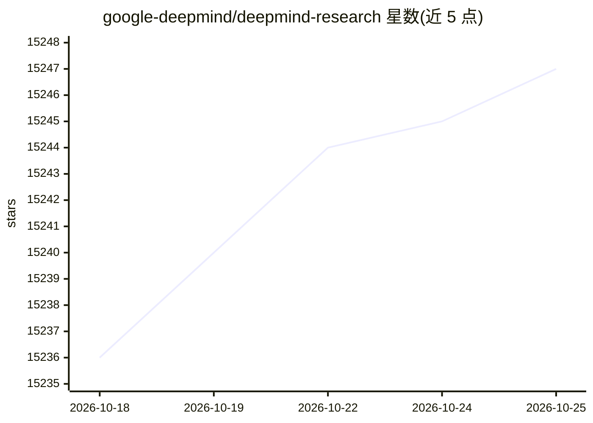

# google-deepmind/deepmind-research

⭐ 15,247 · Jupyter Notebook · Apache-2.0 · 推送 2026-06-17 · [GitHub](https://github.com/google-deepmind/deepmind-research) · 组织维护

**为科研人员提供 DeepMind 论文的配套开源代码与环境**

DeepMind 官方研究仓库，收录其发表论文的实现与示例代码，并开放研究环境、数据集和代码，供更广泛的研究社区在其工作基础上开展研究。仓库以目录形式组织约 60 个论文项目，覆盖强化学习、图网络、生成模型、语言模型、因果推理、蛋白质结构预测（AlphaFold CASP13）等方向。README 未提供统一安装说明，各项目需进入对应目录查看；页面声明这不是 Google 官方产品。

## 筛选速览

| 维度 | 判定 | 备注 |
|---|---|---|
| AI 角色 | `ai-knowledge` | 知识聚合/清单类 |
| 许可风险 | `permissive` | Apache-2.0 |
| 部署形态 | `None` |  |
| 模型依赖 | — | README 未给出锁定关系 |
| 硬件要求 | — | 无带数字的原话,不猜 |
| 安装摩擦 | `low` | 无编译、无系统依赖或容器化 |
| 成熟度 | — | 结构信号不足 |

## 动量与使用信号

- 维护:`maintenance` — 距上次 push 122.8 天,年发版 0,74 位贡献者
- 涨星:近 1 天 **+2**(自 20261016 起算)
- 安装:github 包 `release-assets` 月下载无数据

## 能力要点

- 收录约 60 个 DeepMind 论文的实现与示例代码
- 开放 DeepMind Lab、StarCraft II 等研究环境与数据集
- 覆盖强化学习、图网络、生成模型、AlphaFold 等多方向

## 适用场景

- 复现或基于 DeepMind 论文实现开展研究
- 使用与 DeepMind 相同的环境做强化学习实验
- 查找图网络、无监督表示学习等方向的参考实现

## 场景标签

`科研工具` `强化学习` · 领域:学习与行业

## 证据(README 行号)

> L3: This repository contains implementations and illustrative code to accompany
> L9: enable the broader research community to engage with our work and build upon it,
> L25: ## Projects

## 星数曲线

2026-10-18 15,236 → 2026-10-25 15,247（+11）

---
*卡片 v1 · prompt 1.4 · 生成 2026-10-18 · 置信度 high · 依据 README sha `8edf2b605775` · [字段定义](../../DATASET.md)*
