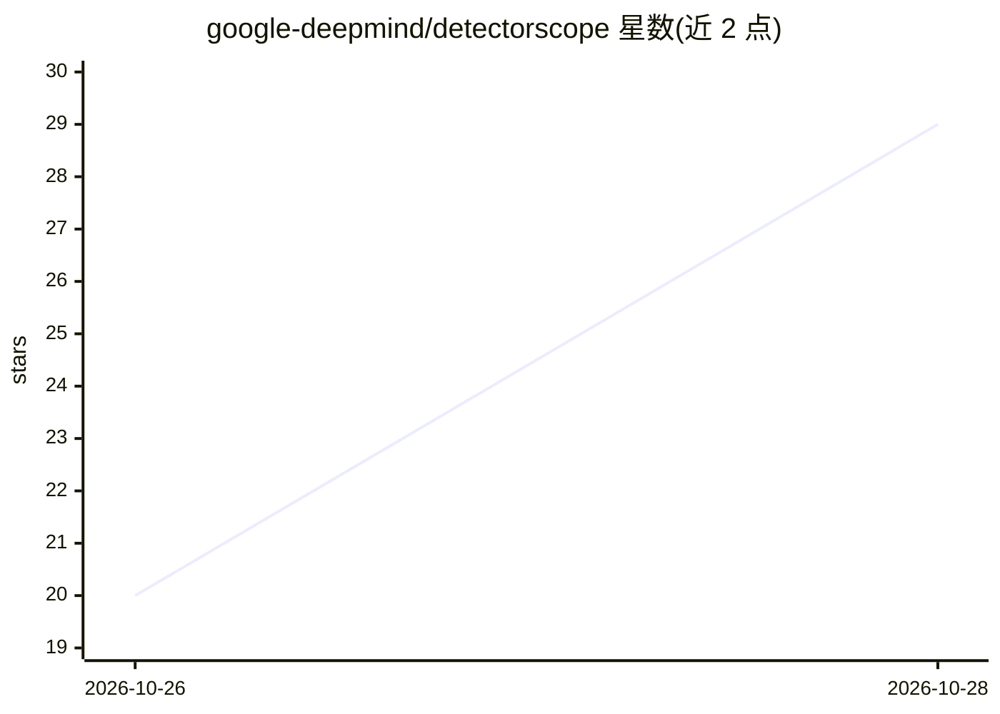

# google-deepmind/detectorscope

⭐ 204 · Python · Apache-2.0 · 推送 2026-10-24 · [GitHub](https://github.com/google-deepmind/detectorscope) · [官网](https://aclanthology.org/2026.emnlp-main.762/) · 组织维护

**可解释 AI 文本检测器：每条预测分解为可读特征**

Google DeepMind 与 Penn NLP 发布的 AI 文本检测库（EMNLP 2026 论文配套）：基于 Gemma-2-2b 残差流上的稀疏自编码器（SAE）特征构建检测器，每个特征带自然语言描述并经激活验证，稀疏线性头使预测等于各特征贡献之和，可定位特征在文本中的位置。提供 PyPI 包、Hugging Face 模型仓库（开放域与同行评审域）、Gradio demo 与论文复现流水线（0-2 阶段需 GPU，其余 CPU）。声明为研究产物，不得用于涉及个人的学术诚信、招聘等决策。

## 筛选速览

| 维度 | 判定 | 备注 |
|---|---|---|
| AI 角色 | `ai-native` | 本体是模型或模型工具 |
| 许可风险 | `permissive` | Apache-2.0 |
| 部署形态 | `library` | 以包/库形式分发 |
| 模型依赖 | — | README 未给出锁定关系 |
| 硬件要求 | `cpu-ok` | |
| 安装摩擦 | `low` | 无编译、无系统依赖或容器化 |
| 成熟度 | — | 结构信号不足 |

## 能力要点

- 预测分解为命名特征的贡献之和，每项有描述与文本位置
- tau 参数调节可解释性与准确率的取舍（默认 0.85，支持 XGBoost 头）
- 提供 Hugging Face 模型仓库，每个分支自带语言模型
- 复现流水线含微调、SAE 训练、自动解释（经 Gemini）与评估各阶段

## 适用场景

- 检测文本是否由 AI 生成并查看判定依据
- 把自己的黑盒检测器转换为可审计的检测器
- 分析不同 LLM 输出的特征倾向
- 复现论文实验与消融分析

## 场景标签

 · 领域:NLP/AI 检测与可解释性

## 证据(README 行号)

> L15: DetectorScope turns a black-box AI text detector into one whose every
> L60: A DetectorScope detector is a concept bottleneck over interpretable sparse-autoencoder
> L61: features: the language model's residual stream is encoded by SAEs, each feature

## 星数曲线

2026-10-26 20 → 2026-10-28 29（+9）

---
*卡片 v1 · prompt 1.4 · 生成 2026-10-28 · 置信度 high · 依据 README sha `9973796f9568` · [字段定义](../../DATASET.md)*
