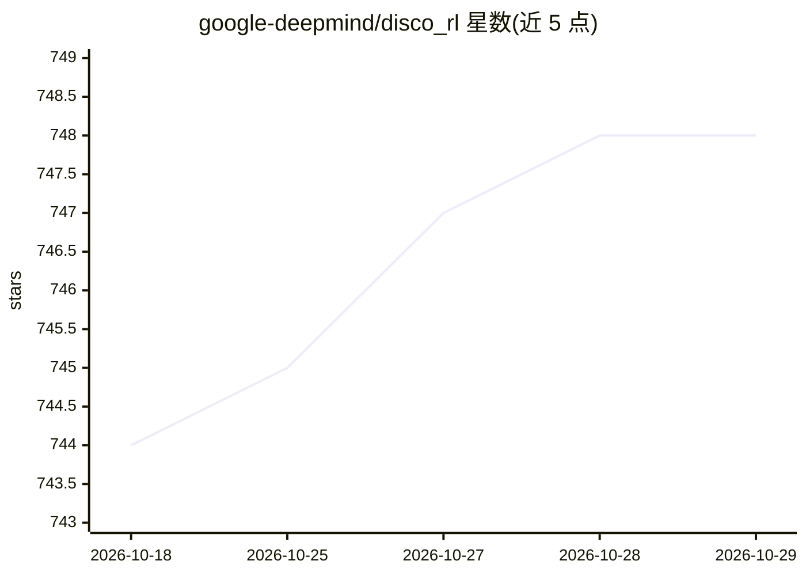

# google-deepmind/disco_rl

⭐ 748 · Python · Apache-2.0 · 推送 2025-12-02 · [GitHub](https://github.com/google-deepmind/disco_rl) · [官网](https://google-deepmind.github.io/disco_rl) · 组织维护

**DiscoRL 论文配套代码：JAX 复现与元学习强化学习更新规则**

Google DeepMind 发布的 Nature 论文《Discovering State-of-the-art Reinforcement Learning Algorithms》伴随代码库：提供基于 JAX 的最小实验框架，含 Disco103 元学习更新规则的原始权重，支持元评估（用发现规则训练智能体）与元训练（从头或从 checkpoint 元学习更新规则），两者均以 Colab notebook 提供。代码含环境接口（Catch 的 CPU 与 jittable 实现）、Haiku 实现的 MLP/LSTM 网络、多种更新规则（发现的规则、actor-critic、策略梯度）与通用 RL 智能体。README 明确声明今后不再积极维护。

## 筛选速览

| 维度 | 判定 | 备注 |
|---|---|---|
| AI 角色 | `ai-native` | 本体是模型或模型工具 |
| 许可风险 | `permissive` | Apache-2.0 |
| 部署形态 | `library` | 以包/库形式分发 |
| 模型依赖 | — | README 未给出锁定关系 |
| 硬件要求 | — | 无带数字的原话,不猜 |
| 安装摩擦 | `low` | 无编译、无系统依赖或容器化 |
| 成熟度 | — | 结构信号不足 |

## 能力要点

- 提供 Disco103 元学习更新规则的原始权重
- 支持元评估与元训练两条路径（Colab notebook）
- 基于 JAX/Haiku 的最小强化学习实验框架

## 适用场景

- 用 Disco103 更新规则训练智能体复现论文结果
- 从头或从 checkpoint 元学习新的 RL 更新规则
- 在 Catch 环境上实验对比发现的规则与 actor-critic/策略梯度

## 场景标签

`强化学习` `模型训练` · 领域:训练与推理

## 证据(README 行号)

> L6: It provides a minimal JAX harness for the DiscoRL setup together with the
> L7:  original meta-learned weights for the *Disco103* discovered update rule.
> L11: - **Meta-evaluation**: training an agent using the *Disco103* discovered RL

## 星数曲线

2026-10-18 744 → 2026-10-29 748（+4）

---
*卡片 v1 · prompt 1.4 · 生成 2026-10-21 · 置信度 high · 依据 README sha `67d7ca1c2c5b` · [字段定义](../../DATASET.md)*
