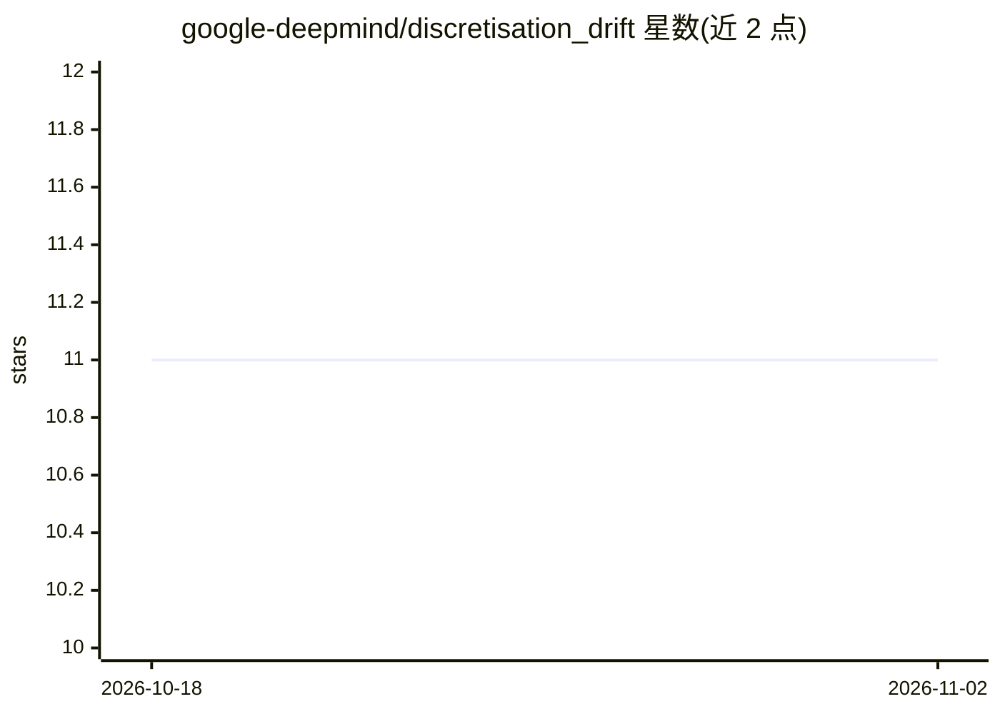

# google-deepmind/discretisation_drift

⭐ 11 · Jupyter Notebook · Apache-2.0 · 推送 2026-07-22 · [GitHub](https://github.com/google-deepmind/discretisation_drift) · 组织维护

**复现梯度下降离散化漂移研究论文的实验代码**

DeepMind 研究者发布的论文配套代码：包含两篇关于梯度下降连续时间模型与二人博弈（GAN）中离散化漂移的实验实现。使用 JAX 训练、TF-GAN 评估（Inception Score/FID），通过 run.sh 脚本训练与评估，提供 CIFAR-10 与 MNIST 配置，支持在配置中指定显式正则化系数以抵消或加强漂移项，并附带测试。principal_flow_instability_single_objective 目录含 PF/DAL 的 colab 实现。需自行编辑脚本适配 GPU/CPU/TPU 设备与驱动。

## 筛选速览

| 维度 | 判定 | 备注 |
|---|---|---|
| AI 角色 | `ai-native` | 本体是模型或模型工具 |
| 许可风险 | `permissive` | Apache-2.0 |
| 部署形态 | `None` |  |
| 模型依赖 | — | README 未给出锁定关系 |
| 硬件要求 | — | 无带数字的原话,不猜 |
| 安装摩擦 | `medium` | 含编译或系统依赖之一 |
| 成熟度 | — | 结构信号不足 |

## 能力要点

- JAX 训练 + TF-GAN 评估（Inception Score/FID）
- run.sh 一键训练/评估，支持 checkpoint 恢复
- 可配置显式正则化系数抵消/加强离散化漂移项
- 提供 CIFAR-10/MNIST 实验配置与测试文件

## 适用场景

- 复现 ICML 2021 离散化漂移论文实验
- 研究 GAN 训练中的漂移项与显式正则化
- 对比 SGD/Adam/RungeKutta4 等优化方法的漂移行为

## 场景标签

`科研工具` · 领域:学习与行业

## 证据(README 行号)

> L15: This is the code reproducing the ICML 2021 paper
> L20:  The code uses JAX for training and TensorFlow (via TF-GAN) for evaluation.

## 星数曲线

2026-10-18 11 → 2026-11-02 11（+0）

---
*卡片 v1 · prompt 1.4 · 生成 2026-11-02 · 置信度 high · 依据 README sha `b5c4134501ee` · [字段定义](../../DATASET.md)*
