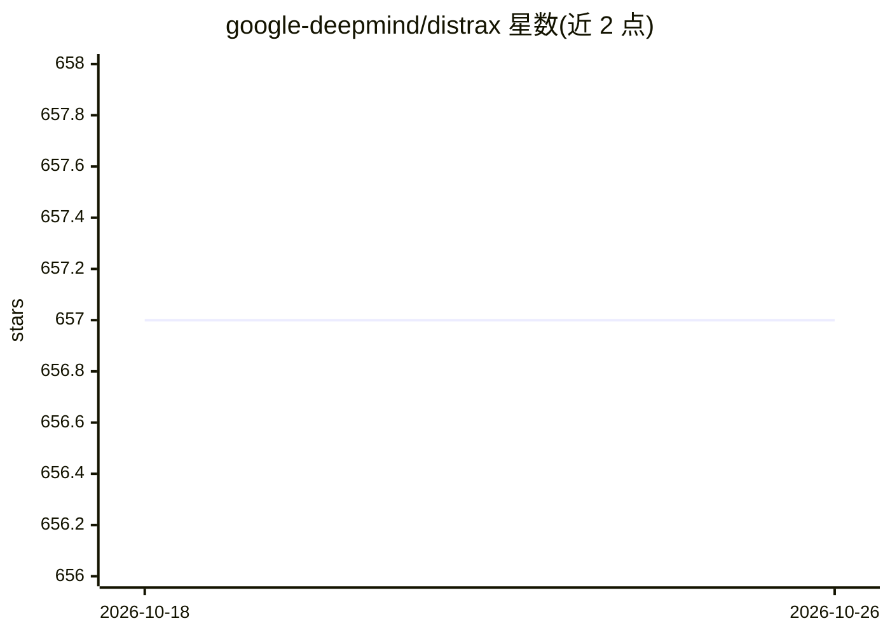

# google-deepmind/distrax

⭐ 657 · Python · Apache-2.0 · 推送 2026-10-20 · [GitHub](https://github.com/google-deepmind/distrax) · 组织维护

**JAX 概率分布与双射器库，供开发者构建概率模型**

DeepMind JAX 生态下的概率分布与 bijector（可逆变换）轻量库，作为 TensorFlow Probability (TFP) 子集的 JAX 原生重实现并强调可扩展性。提供采样、log 概率、Jacobian 行列式计算，支持与 TFP 类双向转换、jit/vmap/pmap、通过子类化自定义分布与双射器；vmap/pmap 序列化支持为实验性且不完整。附 HMM、VAE、归一化流示例。面向使用 JAX 做概率建模的开发者与研究者。

## 筛选速览

| 维度 | 判定 | 备注 |
|---|---|---|
| AI 角色 | `ai-native` | 本体是模型或模型工具 |
| 许可风险 | `permissive` | Apache-2.0 |
| 部署形态 | `library` | 以包/库形式分发 |
| 模型依赖 | — | README 未给出锁定关系 |
| 硬件要求 | — | 无带数字的原话,不猜 |
| 安装摩擦 | `low` | 无编译、无系统依赖或容器化 |
| 成熟度 | `idea` | |

## 能力要点

- 分布与 TFP 跨兼容，提供 to_tfp 双向转换工具
- bijector 支持组合、求逆与 Lambda 包装 JAX 函数
- sample_and_log_prob / forward_and_log_det 一次性融合计算
- 子类化 Distribution/Bijector 即可自定义并获得 jit 兼容

## 适用场景

- 在 JAX 中构建 VAE、归一化流等概率模型
- 强化学习中定义自定义概率智能体策略
- 需要与 TFP 代码互操作的 JAX 项目

## 场景标签

 · 领域:机器学习库/概率建模

## 证据(README 行号)

> L6: Distrax is a lightweight library of probability distributions and bijectors. It
> L8: TensorFlow Probability (TFP), with

## 星数曲线

2026-10-18 657 → 2026-10-26 657（+0）

---
*卡片 v1 · prompt 1.4 · 生成 2026-10-21 · 置信度 high · 依据 README sha `fc682019836b` · [字段定义](../../DATASET.md)*
