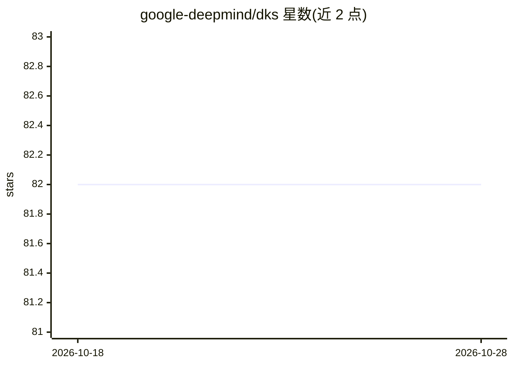

# google-deepmind/dks

⭐ 82 · Python · Apache-2.0 · 推送 2026-10-14 · [GitHub](https://github.com/google-deepmind/dks) · 组织维护

**Deep Kernel Shaping/TAT 的多框架 Python 实现：改造网络使其更易训练**

DeepMind 维护的 Python 包，实现 DKS 与 TAT 论文中的激活函数变换、权重初始化与数据预处理（Per-Location Normalization），用于构造/变换神经网络使其更易训练，例如配合 K-FAC 训练无跳跃连接和归一化层的深层卷积网络。支持 JAX、PyTorch、TensorFlow 三个框架的独立子包，需用户自行导入并将方法嵌入自己的模型代码。限制：ReLU 仅被 DKS 部分支持且不推荐使用；不接受 GitHub PR。通过 pip（GitHub/PyPI）安装。

## 筛选速览

| 维度 | 判定 | 备注 |
|---|---|---|
| AI 角色 | `ai-native` | 本体是模型或模型工具 |
| 许可风险 | `permissive` | Apache-2.0 |
| 部署形态 | `library` | 以包/库形式分发 |
| 模型依赖 | — | README 未给出锁定关系 |
| 硬件要求 | — | 无带数字的原话,不猜 |
| 安装摩擦 | `low` | 无编译、无系统依赖或容器化 |
| 成熟度 | — | 结构信号不足 |

## 能力要点

- 激活函数变换、权重初始化与 PLN 数据预处理三项能力
- 支持 JAX / PyTorch / TensorFlow 三框架子包
- 提供改造为 vanilla 网络的 Haiku ResNet 示例模型
- 配合 K-FAC 可训练无跳跃连接与归一化层的深层卷积网络

## 适用场景

- 按 DKS/TAT 论文方法改造自己的神经网络模型以降低训练难度
- 在 JAX/PyTorch/TensorFlow 项目中引入变换后的激活函数与初始化
- 参考示例模型构建去除归一化层和跳跃连接的 vanilla 网络

## 场景标签

`模型训练` · 领域:训练与推理

## 证据(README 行号)

> L6: This Python package implements the activation function transformations, weight
> L15: The package supports the JAX, PyTorch, and TensorFlow tensor programming

## 星数曲线

2026-10-18 82 → 2026-10-28 82（+0）

---
*卡片 v1 · prompt 1.4 · 生成 2026-10-24 · 置信度 high · 依据 README sha `65afb1787921` · [字段定义](../../DATASET.md)*
