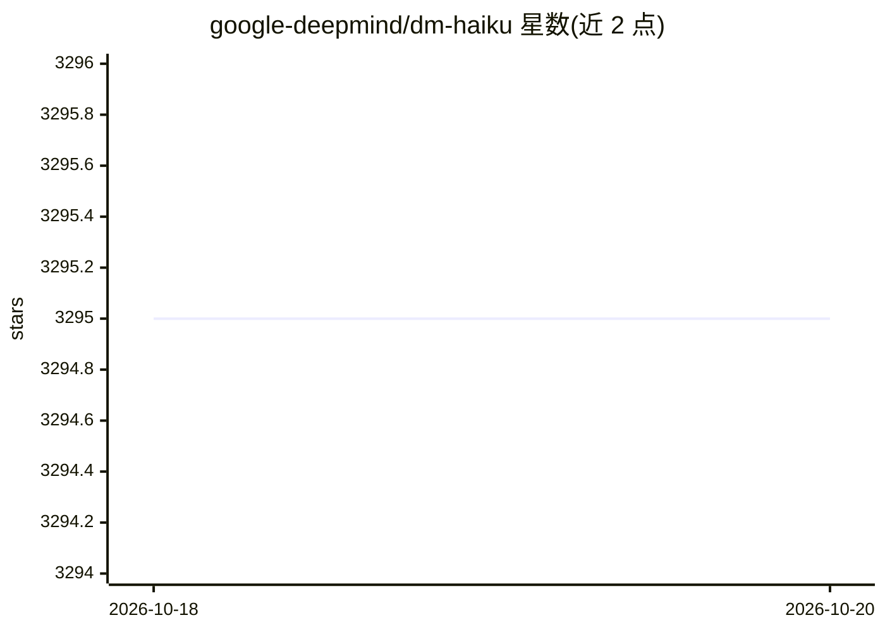

# google-deepmind/dm-haiku

⭐ 3,295 · Python · Apache-2.0 · 推送 2026-10-05 · [GitHub](https://github.com/google-deepmind/dm-haiku) · [官网](https://dm-haiku.readthedocs.io) · 组织维护

**面向 JAX 的神经网络库：用面向对象模块构建可变换纯函数**

Google DeepMind 开发的 JAX 神经网络库，由 Sonnet 作者团队打造，提供 hk.Module 模块抽象与 hk.transform 函数变换，把面向对象的模型代码转为可配合 jax.jit/grad/pmap 使用的纯函数（init/apply 对），并内置参数管理、随机数 PRNG 序列与可变状态 API。官方声明自 2023 年 7 月起进入维护模式：仅修复 bug 和保持与新版 JAX/Python 兼容，不再新增功能，新项目被建议采用 Flax。以 Python 库形式经 pip/PyPI 安装，JAX 需按 CUDA 版本另行安装。

## 筛选速览

| 维度 | 判定 | 备注 |
|---|---|---|
| AI 角色 | `ai-native` | 本体是模型或模型工具 |
| 许可风险 | `permissive` | Apache-2.0 |
| 部署形态 | `library` | 以包/库形式分发 |
| 模型依赖 | — | README 未给出锁定关系 |
| 硬件要求 | — | 无带数字的原话,不猜 |
| 安装摩擦 | `medium` | 含编译或系统依赖之一 |
| 成熟度 | — | 结构信号不足 |

## 能力要点

- hk.Module + hk.transform 将面向对象模型转为 JAX 纯函数
- 内置 PRNG 键序列（hk.next_rng_key）与模块级可变状态 API
- 支持 jax.pmap 多加速器数据并行训练，内置 ResNet50 等 hk.nets 网络
- 不自定义优化器/检查点/复制 API，定位为可与其它库组合的库而非框架

## 适用场景

- 在 JAX 生态中沿用 Sonnet 式模块化编程模型构建神经网络
- 管理模型参数、随机数与 BatchNorm 类内部状态
- 多 GPU/TPU 上做数据并行训练（jax.pmap）

## 场景标签

 · 领域:深度学习/机器学习库

## 证据(README 行号)

> L47: Haiku is a simple neural network library for [JAX] developed by some of the
> L60: Haiku is a simple neural network library for JAX that enables users to use
> L64: Haiku provides two core tools: a module abstraction, `hk.Module`, and a simple

## 星数曲线

2026-10-18 3,295 → 2026-10-20 3,295（+0）

---
*卡片 v1 · prompt 1.4 · 生成 2026-10-20 · 置信度 high · 依据 README sha `8f520d9e588d` · [字段定义](../../DATASET.md)*
