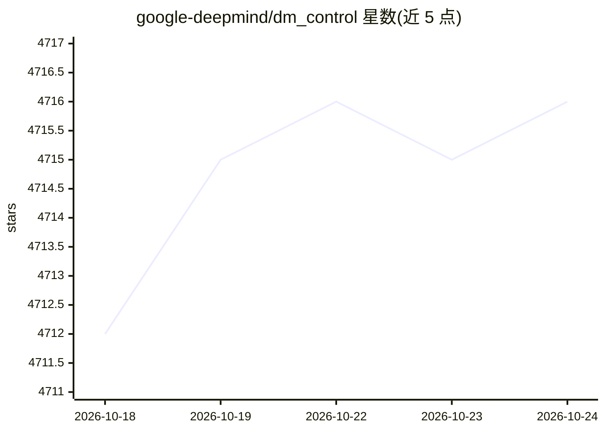

# google-deepmind/dm_control

⭐ 4,716 · Python · Apache-2.0 · 推送 2026-10-23 · [GitHub](https://github.com/google-deepmind/dm_control) · 组织维护

**基于 MuJoCo 物理引擎的强化学习环境库**

Google DeepMind 的物理仿真软件栈：提供 MuJoCo 物理引擎的 Python 绑定、一组基于 MuJoCo 的连续控制强化学习环境（dm_control.suite）、交互式环境查看器，以及用于构建自定义控制任务的 MJCF 模型组合库、composer 环境定义库和 locomotion/soccer 等任务库。面向做基于物理仿真的 RL 研究与开发的用户。通过 pip 从 PyPI 安装，不支持 editable 模式；渲染需 EGL/GLFW/OSMesa 三种 OpenGL 后端之一。

## 筛选速览

| 维度 | 判定 | 备注 |
|---|---|---|
| AI 角色 | `ai-ecosystem` | LLM/agent 周边工具 |
| 许可风险 | `permissive` | Apache-2.0 |
| 部署形态 | `library` | 以包/库形式分发 |
| 模型依赖 | — | README 未给出锁定关系 |
| 硬件要求 | — | 无带数字的原话,不猜 |
| 安装摩擦 | `low` | 无编译、无系统依赖或容器化 |
| 成熟度 | — | 结构信号不足 |

## 能力要点

- MuJoCo 物理引擎的 Python 绑定
- 预置一组基于物理的连续控制 RL 环境（suite）
- MJCF 模型组合库与 composer 可复用组件化环境定义
- 支持 EGL/GLFW/OSMesa 三种渲染后端及 GPU 选择

## 适用场景

- 在 MuJoCo 物理仿真中训练和评测连续控制 RL 智能体
- 用 MJCF 和 composer 组合自定义机器人任务
- 多智能体 soccer 任务研究

## 场景标签

`强化学习` · 领域:训练与推理

## 证据(README 行号)

> L3: Google DeepMind's software stack for physics-based simulation and Reinforcement
> L17: - [`dm_control.suite`]: A set of Python Reinforcement Learning environments
> L28: - `dm_control.composer`: A library for defining rich RL environments from

## 星数曲线

2026-10-18 4,712 → 2026-10-24 4,716（+4）

---
*卡片 v1 · prompt 1.4 · 生成 2026-10-20 · 置信度 high · 依据 README sha `68e59150adcf` · [字段定义](../../DATASET.md)*
