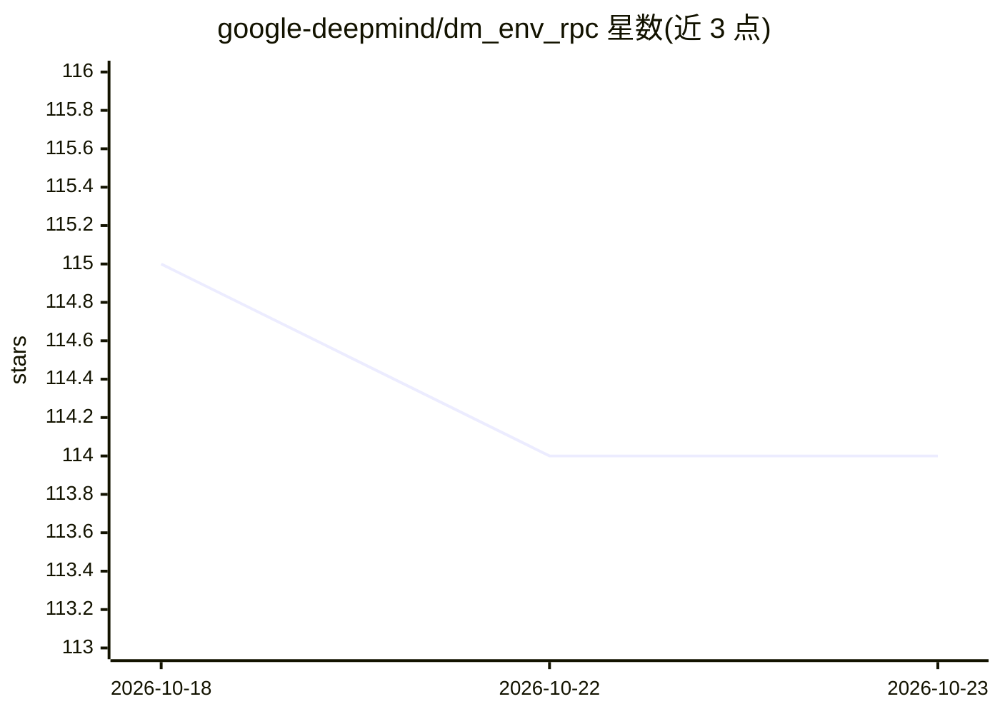

# google-deepmind/dm_env_rpc

⭐ 114 · Python · Apache-2.0 · 推送 2026-10-15 · [GitHub](https://github.com/google-deepmind/dm_env_rpc) · 组织维护

**智能体与环境间的 gRPC 通信协议库，用于 RL 环境标准化交互**

DeepMind 维护的 Python 包，提供基于 gRPC 双向流 RPC 的智能体-环境通信协议，并包含 dm_env 接口实现，使游戏等可暴露为强化学习环境。目标是让双方无需了解对方技术栈即可跨进程、跨机器通信，游戏开发者可用最少领域知识接入环境，研究人员可在大量游戏上测试智能体。附示例目录与协议文档；README 注明非官方支持的 Google 产品。

## 筛选速览

| 维度 | 判定 | 备注 |
|---|---|---|
| AI 角色 | `ai-ecosystem` | LLM/agent 周边工具 |
| 许可风险 | `permissive` | Apache-2.0 |
| 部署形态 | `library` | 以包/库形式分发 |
| 模型依赖 | — | README 未给出锁定关系 |
| 硬件要求 | — | 无带数字的原话,不猜 |
| 安装摩擦 | `low` | 无编译、无系统依赖或容器化 |
| 成熟度 | — | 结构信号不足 |

## 能力要点

- 基于 gRPC 双向流 RPC 的智能体-环境通信协议
- 跨进程/跨机器通信，双方技术栈可不同
- 包含 dm_env Python 接口实现
- examples 目录提供用该协议实现的 RL 环境示例

## 适用场景

- 游戏开发者将游戏暴露为标准化 RL 环境
- 研究人员在多个不同游戏环境上测试智能体
- 需要智能体与环境跨机器分布式运行的实验

## 场景标签

`强化学习` · 领域:训练与推理

## 证据(README 行号)

> L6: `dm_env_rpc` is a remote procedure call (RPC) protocol for communicating between
> L7: machine learning agents and environments. It uses gRPC as
> L30: This protocol also removes the need for agents and environments to run in the

## 星数曲线

2026-10-18 115 → 2026-10-23 114（-1）

---
*卡片 v1 · prompt 1.4 · 生成 2026-10-23 · 置信度 high · 依据 README sha `72e6284152de` · [字段定义](../../DATASET.md)*
