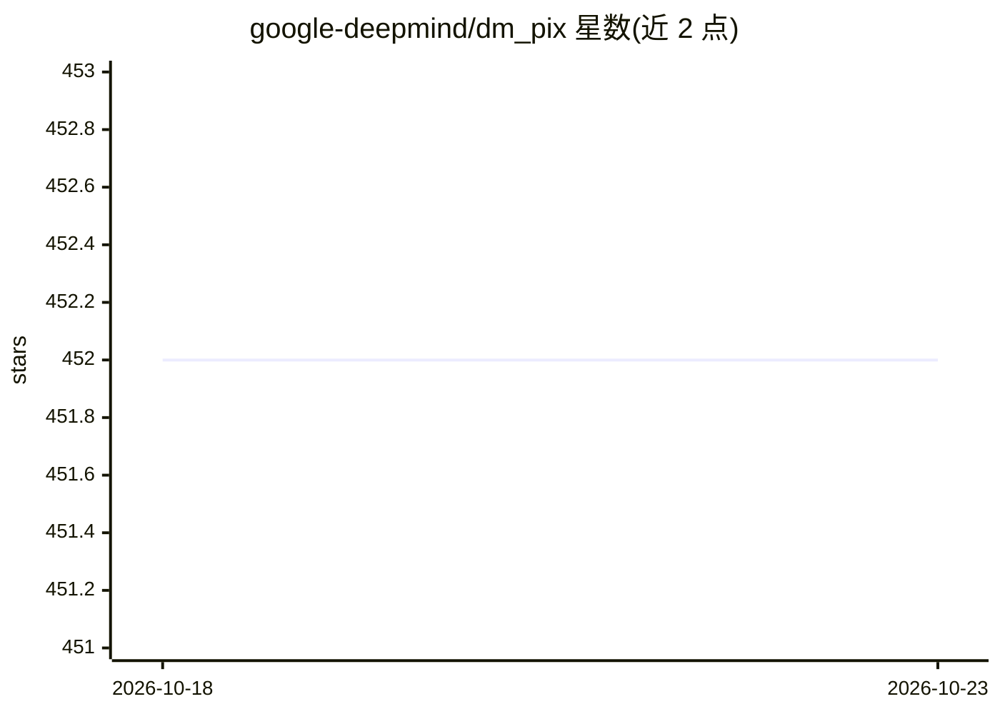

# google-deepmind/dm_pix

⭐ 452 · Python · Apache-2.0 · 推送 2026-10-16 · [GitHub](https://github.com/google-deepmind/dm_pix) · [官网](https://dm-pix.readthedocs.io) · 组织维护

**基于 JAX 的图像处理函数库，支持 jit/vmap/pmap 加速**

PIX 是 DeepMind JAX Ecosystem 中的纯 Python 图像处理库，构建于 JAX 之上，提供翻转等图像处理函数与工具，所有函数可经 jax.jit、jax.vmap、jax.pmap 进行编译优化与并行化。面向使用 JAX 做机器学习研究的开发者。安装需先按官方指引安装带对应加速器支持的 JAX（因 CUDA 版本差异，JAX 未列为硬依赖），再 pip install dm-pix。附示例文件夹与 pytest 测试套件。

## 筛选速览

| 维度 | 判定 | 备注 |
|---|---|---|
| AI 角色 | `ai-ecosystem` | LLM/agent 周边工具 |
| 许可风险 | `permissive` | Apache-2.0 |
| 部署形态 | `library` | 以包/库形式分发 |
| 模型依赖 | — | README 未给出锁定关系 |
| 硬件要求 | — | 无带数字的原话,不猜 |
| 安装摩擦 | `medium` | 含编译或系统依赖之一 |
| 成熟度 | — | 结构信号不足 |

## 能力要点

- 所有函数支持 jax.jit / vmap / pmap 优化与并行化
- 纯 Python 编写，依赖 JAX 提供的 C++ 后端
- 提供示例与 pytest 测试套件（test.sh 隔离环境脚本）
- DeepMind JAX Ecosystem 组成部分

## 适用场景

- 在 JAX 流水线中做可微、可并行化的图像变换
- 为机器学习研究项目准备与增强图像数据
- 测试本机 JAX/加速器开发环境

## 场景标签

`图像视频处理` · 领域:感知与多模态

## 证据(README 行号)

> L3: PIX is an image processing library in [JAX], for [JAX].
> L15: PIX is a library built on top of JAX with the goal of providing image processing
> L16: functions and tools to JAX in a way that they can be optimised and parallelised
> L17: through [`jax.jit`][jit], [`jax.vmap`][vmap] and [`jax.pmap`][pmap].

## 星数曲线

2026-10-18 452 → 2026-10-23 452（+0）

---
*卡片 v1 · prompt 1.4 · 生成 2026-10-21 · 置信度 high · 依据 README sha `b70e440d61f9` · [字段定义](../../DATASET.md)*
