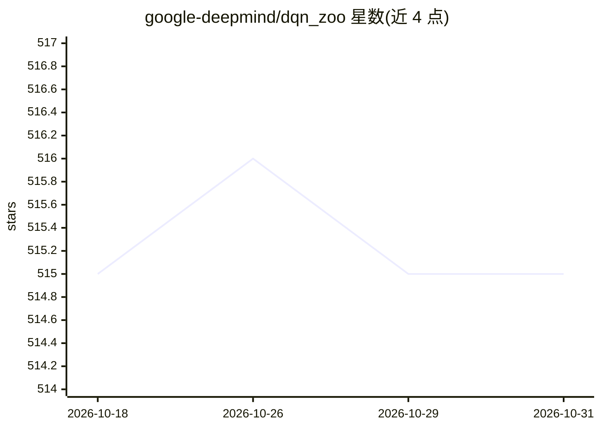

# google-deepmind/dqn_zoo

⭐ 515 · Python · Apache-2.0 · 推送 2026-07-20 · [GitHub](https://github.com/google-deepmind/dqn_zoo) · 组织维护

**DeepMind DQN 系列强化学习 agent 的参考实现集合，供研究复现与二次开发**

DeepMind 维护的 DQN 变体参考实现集合，收录 DQN、Double Q、优先回放、C51、QR-DQN、Rainbow、IQN 等七种 agent，全部用 Python 及 JAX/Haiku/RLax 实现，各自复现对应论文在 57 个 Atari 游戏上的平均结果。定位为研究友好、可读、自包含的代码，明确不做通用库或框架，预期使用方式是 fork 后修改。仅支持 Python 3.9+ 与 Linux，提供 Docker 快速启动脚本，GPU 可选（可 --jax_platform_name=cpu 跑 CPU），并附带学习曲线数据。

## 筛选速览

| 维度 | 判定 | 备注 |
|---|---|---|
| AI 角色 | `ai-native` | 本体是模型或模型工具 |
| 许可风险 | `permissive` | Apache-2.0 |
| 部署形态 | `self-host` | docker 或自建部署 |
| 模型依赖 | — | README 未给出锁定关系 |
| 硬件要求 | — | 无带数字的原话,不猜 |
| 安装摩擦 | `low` | 无编译、无系统依赖或容器化 |
| 成熟度 | — | 结构信号不足 |

## 能力要点

- 七种 DQN 变体（DQN/Double Q/Prioritized/C51/QR-DQN/Rainbow/IQN）的参考实现
- 基于 JAX/Haiku/RLax，纯 Python，最小依赖
- 各 agent 在 57 个 Atari 游戏上平均复现论文结果
- 提供 run.sh + Docker 自包含快速启动路径，含学习曲线数据（results.tar.gz）

## 适用场景

- 对照论文学习或复现 DQN 系列算法
- fork 某个 agent 修改为自己的研究变体
- 查看各 agent 在 Atari 上的训练曲线数据

## 场景标签

`强化学习` · 领域:训练与推理

## 证据(README 行号)

> L3: *DQN Zoo* is a collection of reference implementations of reinforcement learning
> L16: |`dqn`|Human Level Control Through Deep Reinforcement Learning|
> L76: * Be a library or framework (these agents are intended to be forked for

## 星数曲线

2026-10-18 515 → 2026-10-31 515（+0）

---
*卡片 v1 · prompt 1.4 · 生成 2026-10-21 · 置信度 high · 依据 README sha `0bce9692c0ad` · [字段定义](../../DATASET.md)*
