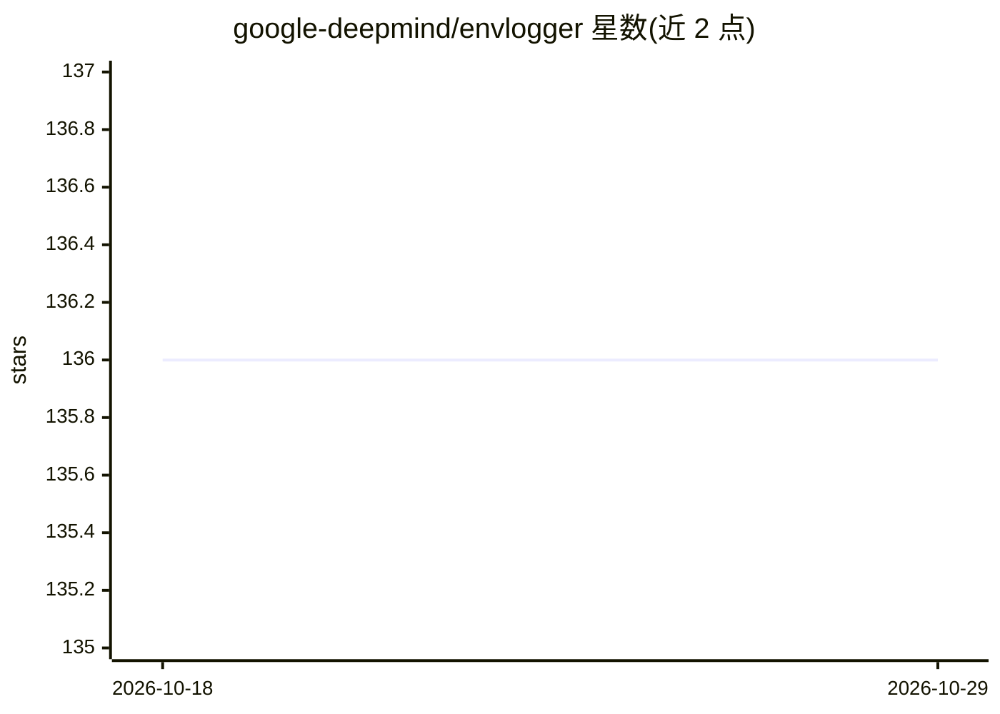

# google-deepmind/envlogger

⭐ 136 · Python · Apache-2.0 · 推送 2026-10-07 · [GitHub](https://github.com/google-deepmind/envlogger) · 组织维护

**RL 环境交互轨迹录制工具：dm_env 包装器记录与回读数据**

EnvLogger 是 DeepMind 开发的 dm_env.Environment 包装器，用于录制智能体与真实环境之间的交互，以轨迹形式保存到磁盘，支持整体读取、按时间步或按回合读取。默认使用 Riegeli 后端存储压缩格式，支持每步与每回合自定义元数据回调，录制的数据集与 RLDS 兼容。包装后每环境步增加约 2 毫秒开销。仅支持 Linux 与 Python 3，运行时需要 GMP 库，源码构建须使用 Bazel。

## 筛选速览

| 维度 | 判定 | 备注 |
|---|---|---|
| AI 角色 | `ai-ecosystem` | LLM/agent 周边工具 |
| 许可风险 | `permissive` | Apache-2.0 |
| 部署形态 | `self-host` | docker 或自建部署 |
| 模型依赖 | — | README 未给出锁定关系 |
| 硬件要求 | — | 无带数字的原话,不猜 |
| 安装摩擦 | `low` | 无编译、无系统依赖或容器化 |
| 成熟度 | — | 结构信号不足 |

## 能力要点

- dm_env.Environment 包装器录制智能体-环境交互轨迹
- 默认 Riegeli 后端压缩存储，无需复杂数据集 schema
- 支持逐步/逐回合自定义元数据回调
- 数据集兼容 RLDS，可用 Reader 回读

## 适用场景

- 为强化学习实验保存可回读的交互轨迹数据
- 离线 RL 数据集录制并转换为 RLDS/TFDS 格式
- 为每个训练步与回合附加时间戳等自定义元数据

## 场景标签

`强化学习` · 领域:训练与推理

## 证据(README 行号)

> L3: `EnvLogger` is a standard `dm_env.Environment` class wrapper that
> L108: > EnvLogger currently only supports Linux based OSes and Python 3.

## 星数曲线

2026-10-18 136 → 2026-10-29 136（+0）

---
*卡片 v1 · prompt 1.4 · 生成 2026-10-22 · 置信度 high · 依据 README sha `cf99f328aabd` · [字段定义](../../DATASET.md)*
